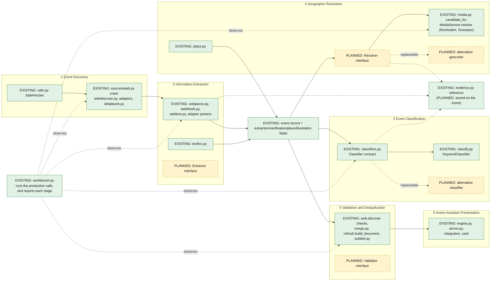

# Area Events: functional modules (migration, milestone 1)

Area Events is being organised into six functional modules, each of which can be replaced or improved on its own and judged against the same event evidence. This milestone does **not** rewrite anything: it names the modules, maps them onto the code that exists, makes the **classifier** the first module behind an explicit contract, defines a shared evidence reference, and adds the **Event Analysis Workbench**, a local tool that shows each module's work product by running the production code.

Labels below: **EXISTING** is code in this repository today; **PLANNED** is a boundary or module that does not exist yet.

## The six modules and the code behind them

| # | Module | Responsibility | EXISTING implementation (files under `area_events/discovery/` unless noted) |
|---|---|---|---|
| 1 | **Event Discovery** | Find where events are published and fetch them politely and safely: listings, calendars, feeds, event and detail pages, linked documents. Own page/detail work and its retry state. | `safe.py` (SafeFetcher: public addresses only, robots.txt, limits), `core.Fetcher`, `sources/web.py` (`crawl`), `sources/webdiscover.py`, `sources/detailwork.py`, the listing/detail halves of `sources/sandiegoreader.py`, `dosd.py`, `sandiego_gov.py`, `kpbs.py`, `localist.py`, `registry.py`, `profiles.py` |
| 2 | **Information Extraction** | Turn fetched pages and documents into event candidates with the fields they state (title, start/end, venue, address, description, price, image), each traceable to its source. | `sources/webparse.py` (JSON-LD, microdata, listing blocks), `sources/webfeeds.py` (ICS, RSS), `sources/webtext.py` (text and PDF), `sources/webtime.py`, the `_parse_*` functions of each adapter, `core.py` (`make_event`, `normalize_event_text`, `clean_text`), `textloc.py` (addresses, parks, corners in text) |
| 3 | **Event Classification** | Decide which illustration category an event is about and say why. | `classifiers.py` (the contract, EXISTING since this milestone), `classify.py` (the keyword-lexicon implementation), `photo_subject.py` |
| 4 | **Geographic Resolution** | Decide where an event is and how sure that is: source coordinates, addresses, named places, street corners; refuse what cannot be verified. | `place.py` (place class from source data), `location.py` (the search area), `media.py` (`candidate_for`, `accept_geocode`, intersections, `MediaService.resolve`), `textloc.py` |
| 5 | **Validation and Deduplication** | Decide which records are real, current and the same event; build the feed. | `sources/web.py` (`discover`: dates, time zones, duplicates), `core.finish_event`, `merge.py`, `refresh.py` (`build_document`: expiry, retention, merge), `images.py`, `publish.py` (`validate_feed`) |
| 6 | **Home Assistant Presentation** | Serve the feed and its imagery to Home Assistant and draw it. | `server.py`, `engine.py` (`snapshot`, scheduling), `media.py` (stored maps and photos), `maps.py`, `custom_components/area_events/*`, `src/area-events-card.js` |

### Responsibilities that are mixed today

- `sources/web.py:discover` is extraction, date validation, time-zone handling and duplicate removal in one function; each adapter mixes listing paging, parsing and detail fetching.
- `media.py` holds geographic resolution, venue-photo verification, map assets, the cache store and the background service in one module; the resolver cannot be replaced without the imagery.
- `refresh.build_document` merges, classifies (now through `classifiers.annotate`), assigns photo subjects and chooses images.
- `engine.py` schedules discovery, runs the imagery loop and assembles the API answer.
- `textloc.py` reads text for the extraction stage but is consumed by the geographic stage.

## Proposed boundaries (contracts)

| Module | Input → output | State |
|---|---|---|
| Discovery | a source (URL or adapter) and a budget → `Page`/`Document` records (url, status, body or text, content type) and a work log | EXISTING in practice (the recording client of the workbench shows it); PLANNED as an interface |
| Extraction | pages/documents → **candidates** (fields + evidence references) | PLANNED as an interface; candidates already have a stable dict format (`kind`, `title`, `start`, …, `evidence_text`) |
| Classification | event → **decision** `{category, strength, reasons, fallback, scores}` | **EXISTING**: `classifiers.Classifier`, see below |
| Geographic Resolution | event → **resolution** `{status, location, confidence, precision, approximate, provenance, reason}` | PLANNED as an interface (`media.MediaService.resolve` is its only implementation) |
| Validation and Deduplication | candidates/events → accepted events, rejections with reasons, merge decisions | PLANNED as an interface (`refresh.build_document`, `merge.py`) |
| Presentation | feed + stored imagery → API answer | EXISTING (`engine.snapshot`, WebSocket command) |

### The first replaceable module: classification

Contract (documented in `classifiers.py`, enforced by `classifiers.check_decision` and `decide`):

- **input**: one event record in the Area Events schema; a classifier may read any field and must not change the event;
- **output**: `{"category": one of the 17 categories, "strength": "strong|moderate|weak|none", "reasons": [text], "fallback": bool, "scores": {category: number}}` (`scores` optional);
- **failures**: an exception or an invalid decision never reaches the feed; `annotate` records the general category and says why.

`KeywordClassifier` wraps `classify.classify` unchanged, so production behaviour is identical (`tests/test_modules.py` compares `classifiers.annotate` with `classify.annotate` on the reviewed real-event set). The feed builder and the workbench call `classifiers.annotate` / `classifiers.current()`; a different implementation is installed with `classifiers.use(MyClassifier())` (or `set_classifier`) and nothing that consumes the decision changes. The tests install a constant classifier and a failing one to prove this.

### How a replacement geocoder would be installed (PLANNED)

Introduce a `Resolver` contract with the resolution above, make today's Nominatim and Overpass logic in `media.py` the first implementation (`NominatimResolver`), and have `MediaService` call `resolver.resolve(candidate)` instead of its own method. A new provider, or a local gazetteer, is then another class installed the same way; the map drawing, photo verification and the card do not change. This is the next stage in the sequence below.

## Shared event and evidence model

The event record stays the existing schema (`core.make_event`). Modules attach what they decided and why to the same record rather than re-reading the source text:

| Where it is recorded today | Written by | Contents |
|---|---|---|
| `extraction.method`, `extraction.source_text` | web adapter | how the candidate was read (`jsonld`, `microdata`, `ics`, `feed`, `html`, `text`, `pdf`) and, for text and PDF events, the exact line it came from |
| `verification.evidence`, `verification.missing` | adapters, `finish_event` | statements about the source's own signals; the fields that are absent |
| `place.evidence` | `place.py` | what is known about the location from the source |
| `illustration.reasons` | the classifier | the lexicon terms the decision rests on |
| media `location.provenance` | `media.py` | the external verification (geocoder match, shared road node) |

`evidence.py` defines the **evidence reference**, the structure later modules attach consistently: `{field, value, kind, recorded_by, source_url, quote, context, found_in, note}`, where `kind` is `extracted` (in the source), `inferred` (derived by a rule, such as a category from keywords or an ISO date), `verified` (confirmed by an external lookup) or `recorded` (a module's own statement), and `quote`/`context` exist **only** when the value was found verbatim in a source (`evidence.locate`; case is ignored, wording never). Nothing is fabricated: a value that cannot be located says so in `note`. In this milestone the workbench builds the references from what the production code recorded plus an exact-text search of the pages read; moving them into the feed (`event.evidence`) is a later step.

## Ownership of caching and scheduling

| Owner | Caches and state | Scheduling |
|---|---|---|
| Discovery | the per-source event cache (`source-cache.json`, with `extraction.detail_*` state for the detail queue), the 15-minute in-memory crawl cache, robots.txt and per-host rate state in `safe.py` | `engine.py` (`tick`, `run_next`): one profile at a time, hourly by default; per-run detail budgets in the adapters |
| Extraction | none (pure functions) | runs inside discovery |
| Classification | none (pure) | runs when the feed is built |
| Geographic Resolution | `media/index.json` (records, refusals with reasons), tile cache, Nominatim 15 s spacing and Overpass 10 s spacing | `engine._media_loop`: a background thread only while no discovery runs |
| Validation | the merged feed (`events.json`) | `refresh.publish` after each source |
| Presentation | none; the card polls | the integration's coordinator |

## Diagram



(`EV` is marked existing because the reference structure exists in `evidence.py`; storing it in the feed is planned. `GI` is planned because the resolver is not yet behind an interface.)

## Migration sequence

1. **Done (this milestone):** classifier contract, shared evidence reference, workbench, text and PDF candidates carry their source line.
2. **Geographic resolver contract:** `Resolver` interface, `NominatimResolver` from `media.py`, imagery (maps, photos) separated from resolution; a benchmark of resolution decisions on the saved feeds.
3. **Extractor contract:** one function from a page or document to candidates with evidence references; adapters' `_parse_*` become implementations; a per-candidate rejection reason (today only counts) so validation can explain every drop.
4. **Validator contract:** extract date/time-zone checks and duplicate decisions out of `web.discover` into one place that reports per-record decisions.
5. **Evidence in the feed:** store references on the event, show them in the workbench and later the card.
6. **Discovery ownership:** move the detail queue, page cache and conditional requests (ETag, Last-Modified) behind a discovery interface.

Each stage is independently deployable and leaves the feed unchanged until a replacement implementation is installed.

## Event Analysis Workbench v1

A local tool: no server, database or framework. It calls the production functions in production order (`web.crawl`, `web.discover`, `normalize_event_text`, `locate_events`, `refresh.build_document`, `validate_feed`, the installed classifier, `media.candidate_for`, and with `--geocode` the production resolver) and reports what each returned.

```
python scripts/workbench.py url https://example.org/events [--area san-diego|austin] [--geocode N]
python scripts/workbench.py fixture tests/data/workbench/st-agnes-craft-fair.json [--base-url https://…]
```

- **url** reads the website only through SafeFetcher (public addresses, robots.txt, the adapter's 30-request and 100-second budget); `--geocode N` verifies up to N event locations with the real geocoder at its own rate (15 s apart). The default makes no geocoding request.
- **fixture** takes a saved `.html` page, a `.json` manifest (`{"base_url", "pages": {url: html | {"body", "content_type"} | {"body_base64", …}}}`) or schema.org JSON-LD, and makes **no** network request; a link that is not in the fixture is reported as refused, never fetched. Geographic resolution is reported as "not attempted: offline".
- Output goes to `review/workbench/` (Git-ignored): `<site>-<time>.json` (every stage plus evidence references) and a standalone `.html` (no scripts, no external resources, everything escaped). Fixtures used in the demonstration are in `tests/data/workbench/` (small excerpts of public pages).

What each stage shows: **Discovery** the pages and documents fetched with status, the site's own links as ranked by the event-link scorer and whether they were followed, embedded calendars, linked documents with the reason one was not read, and what was deferred; **Extraction** every candidate with its fields and, for text and PDF events, the exact source line, with the adapter's skip counts (the adapter does not record a reason per candidate, and the report says so); **Classification** the decision, scores, reasons and the exact fields and characters the classifier read; **Geolocation** the location candidates in order, the place class, and the lookup (verified, refused with the reason, unavailable, or not attempted); **Validation** accepted events, what the adapter rejected, feed validity and the fields each event lacks; **Output** the final records in the feed schema; and **Evidence** per event.

## Two real examples (analysed 2026-10-22)

**A. John Pizzarelli: Dear Mr. Bennett** (San Diego Reader event page, offline excerpt `tests/data/workbench/pizzarelli-dear-mr-bennett.html`, and the live page).

- *Extracted* (module 2, correct): title, start `2026-10-24T17:30-0700` normalised to Pacific time, venue "JAI at the Conrad", address 7600 Fay Avenue, San Diego, CA 92037, a 790-character description; the live page holds four performances (24 and 25 October, two shows each), all four read.
- *Location* (module 4): an address candidate; with `--geocode` the production resolver verifies it (house number 7600, Fay Ave, OpenStreetMap way 5961791, approximate). Offline it says "not attempted".
- *Classification* (module 3): **general, "conflicting evidence (music 3 vs arts 2.48)"**. The figurative "chemistry" is never read: the classifier reads only the first 600 characters of the description and the word starts at character 685 (the report lists the 600 characters read out of 790), so no science score exists. The decision fails for a different reason, which the scores expose: music (guitarist, vocalist, singer, album) leads by only 0.52 over arts ("sketching" and "drawing" refer to Bennett's paintings), the margin rule rejects it, and a concert by a jazz trio gets the general illustration; "jazz" itself also lies beyond the 600 characters. **Owner: Event Classification** (the 600-character window and the margin rule; the title names no genre).

**B. St. Agnes Women's Guild Holiday Craft Fair** (parish homepage prose, offline excerpt `tests/data/workbench/st-agnes-craft-fair.json`, and the live site).

- *Extracted*: one event with start `2026-11-22T09:00` (Sunday, 9:00 a.m. to 1:00 p.m.) read from the exact line shown in the evidence table. **Title:** "🎄 Save the Date: St. Agnes Women's Guild Holiday Craft Fair , from in St. Agnes Hall. More information here." is the line with its date and time cut out, not a title. **Venue and address missed:** "in St. Agnes Hall" and the church's address ("1140 Evergreen Street") are on the page but in other text blocks; the extractor reads a venue only from an explicit "Location:" label and never takes an address from elsewhere on the page. The end time (1:00 p.m.) is not kept. **Owner: Information Extraction** (`webtext.events_in`: title assembly, venue and end time).
- *Classification*: **arts (weak, title "craft")**; a Christmas-themed holiday craft fair has no "christmas" or "holiday market" term in its title. **Owner: Event Classification** (it works on the polluted title; the lexicon has no "holiday craft fair").
- *Location*: **no location candidate**. Owner: Information Extraction (nothing was extracted for Geographic Resolution to work on).
- *Live site:* the homepage also yields a second text event whose **title does not belong to its source line** ("Religious Education Program" for a line about a wine tasting evening): the title was taken from a neighbouring line. **Owner: Information Extraction**, and a false-looking record the workbench makes visible. The three bulletin PDFs the page links to are not read: two are over the fetcher's size limit, one was beyond the PDF limit; the craft-fair flyer PDF, checked separately, has no readable font table. **Owners: Discovery** (size and count limits) and **Extraction** (PDF fonts).

None of these results was adjusted: production classification and extraction are unchanged by this milestone.

## Not in this milestone

No new NLP or model dependency, no new geocoding provider, no change to which events are found or how they are classified. The workbench's per-candidate rejection reasons, the resolver and extractor contracts, and storing evidence in the feed are the next stages above.
