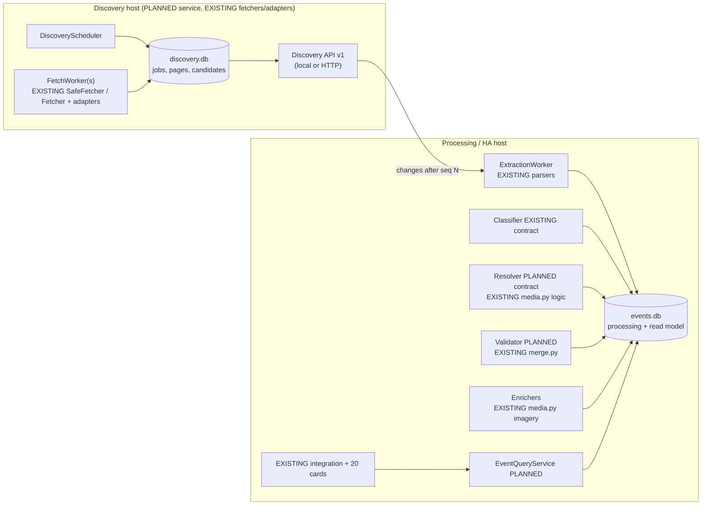
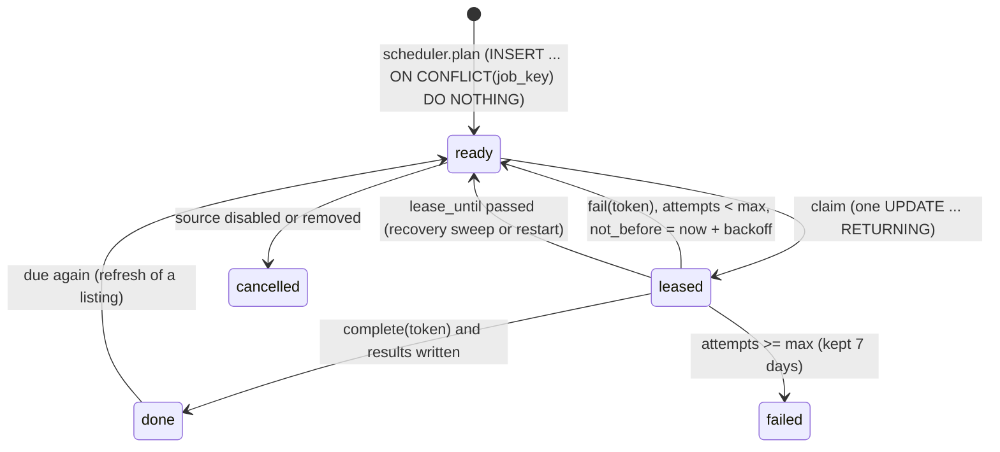
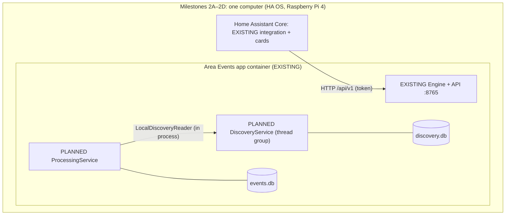
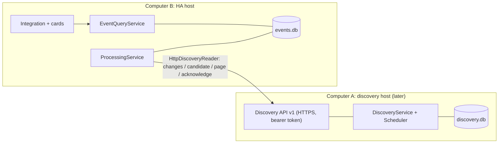

# Discovery Service architecture (Phase A: design for review)

Status: **design only**. Nothing described as PLANNED exists yet. Baseline: commit `881ad8c` on `ha-native-refactor`; accepted runtime tag `area-events-imagery-runtime-accepted-2026-10-22`. Companion documents: [architecture-modules.md](architecture-modules.md) (milestone 1 module map) and [discovery-architecture-review-manifest.md](discovery-architecture-review-manifest.md) (files to review).

Goal of the first implementation slice: **the Discovery Engine independently finds pages and persists them in SQLite**, while the Home Assistant runtime keeps working exactly as today.

---

## 1. Findings from the current code

### A. Reusable capabilities (EXISTING)

| Capability | Where | Reuse |
|---|---|---|
| Safe fetching: public addresses only, pinned connections, validated redirects, robots.txt (RFC 9309), per-host spacing, size, time and content-type limits, binary mode | `area_events/discovery/safe.py` (`SafeFetcher`, `State`) | as is, but its host-politeness state becomes an injected instance (see D) |
| Polite fetching with robots and fixed delay for registry adapters | `core.Fetcher` | as is (it is already instance-owned) |
| Registry of sources with coverage, options and adapter modules | `registry.py` (`load_sources`, `Source`, `select_sources`), `sources.json` | the seed of the `sources` table |
| Source adapters (listing + detail parsers) | `sources/sandiegoreader.py`, `dosd.py`, `sandiego_gov.py`, `kpbs.py`, `localist.py`, `web.py` | wrapped unchanged in milestone 2B; they already return candidates in a stable dict format |
| Bounded website crawl: structured data, feeds, embedded calendars, hub links, PDFs, text | `sources/web.py` (`_Crawl`), `webdiscover.py`, `webparse.py`, `webfeeds.py`, `webtext.py` | the page-level steps become discovery jobs later; today it is one call per site |
| Resumable detail work with backoff | `sources/detailwork.py` (`DetailWork`) | its state model (attempts, `retry_after`, version) maps directly onto the `jobs` table |
| Event record and evidence | `core.make_event`/`finish_event`, `evidence.py`, `extraction.method`/`source_text` | the candidate payload and evidence references |
| Replaceable classifier contract | `classifiers.py` | the model for every processing contract |
| Background imagery worker with its own store and rate limits | `media.py` (`MediaService`, `MediaStore`) | stays on the processing side; already independent of the discovery thread |
| Diagnostic runner over production code | `workbench.py` | becomes the inspector of the discovery database (read-only API) |
| Authenticated app API, Supervisor discovery, token | `server.py`, `supervisor.py`, `custom_components/area_events/client.py` | the transport for a remote Discovery API later |

### B. Mixed responsibilities

- **`refresh.refresh`** fetches every source, normalizes text, locates, merges, classifies, chooses images and writes the feed **in one synchronous call**: discovery and all processing share one run.
- **`engine.Engine`** schedules runs, owns profile lifecycle, assembles API answers, and starts the imagery loop.
- **Each adapter** pages listings, parses them and fetches details inside one `discover()` call.
- **`web.discover`** extracts, validates dates and time zones, and removes duplicates.
- **`media.py`** mixes geographic resolution, venue-photo verification, map rendering, its store and the worker loop.

### C. What blocks independent discovery today

1. **Discovery is driven by cards.** A card's profile (area, radius, websites) is the unit of work: `Engine.register` enqueues a full crawl for every new profile, and every distinct area crawls *all* its sources again (`engine._run` → `refresh.refresh`). Overlapping areas fetch the same pages twice.
2. **Processing is inside the discovery path.** A slow source parser, the merge, classification or the city geocoder (`place.CityResolver`) delays the next source and the next profile.
3. **Discovery stops for imagery and imagery waits for discovery.** `engine._media_loop` runs only while no profile is discovering; they share one process and one data folder.
4. **Capacity is tied to card variety.** `MAX_PROFILES = 12`: twenty cards with different areas, radii or websites exceed it today (HTTP 429, "too many different areas").
5. **No page identity.** Pages exist only transiently inside a run (and in a 15-minute in-memory cache), so nothing can be re-processed without crawling again.

### D. Where mutable state lives

| State | Location | Kind | Problem under the new rules |
|---|---|---|---|
| Per-host request spacing and robots.txt cache | `safe._STATE` (module global `State()`) | process-wide by design (politeness across fetchers) | global mutable state; becomes a `HostPolicy` instance owned by DiscoveryService and injected into every fetcher |
| Crawl result cache | `sources/web._cache`, `_cache_lock` | module global, 15 minutes, 24 entries | global cache; replaced by the `pages` table (and an instance cache if still needed) |
| Installed classifier | `classifiers._current` | module global set by `use()` | violates "no implicit singletons"; the composition root passes the classifier to its consumers; `use()` stays only as a test convenience or is removed |
| stdout/stderr redirection during a run | `engine._run` uses `contextlib.redirect_stdout` | process-global side effect while a run is active | other threads' prints are captured; replaced by a logger passed to adapters |
| Profiles, queue, running flag, feed cache | `Engine` instance (`_profiles`, `_queue`, `_feeds`) | instance-owned, persisted as JSON per profile | fine as objects; persistence moves to SQLite |
| Per-source event cache, detail state | `<data>/profiles/<id>/source-cache.json` | JSON file per profile | duplicated per profile; moves into the discovery database |
| Feeds | `<data>/profiles/<id>/events.json` | JSON file per profile | becomes the validated-event read model |
| Imagery records, tiles, files | `<data>/media/index.json`, `media/files`, `media/tiles` | instance-owned store (`MediaStore`) | stays with Enrichment; its own store |
| Geocoding caches | `geocode-cache.json`, `location-cache.json` | JSON files | stay with their owners (search area: Presentation/profile service; city estimates: Geographic Resolution) |
| Integration hub records | `custom_components/area_events/hub.Hub._records` | instance-owned, in memory | fine |
| Card state | each card element instance, filters in HA `frontend/user_data` | instance-owned per card | fine; already isolated per card |
| Immutable tables (lexicon, suffixes, regexes, providers) | `classify.py`, `media.py`, `location.PROVIDERS` | immutable constants or stateless objects | permitted |

### E. How things are identified today

| Thing | Identifier |
|---|---|
| Source | registry id (`sandiegoreader`, `dosd`, `sandiego_gov`, …); typed-in websites `web_<sha1(url)[:8]>`, `localist_<sha1(host)[:8]>` (`engine._probe_added`) |
| Profile (card request) | `sha256(normalized profile)[:16]` (`profiles.profile_id`), also the folder name |
| Event | `<source_id>:<local_id>`; local ids come from the adapter (Reader `?et=`, DoSD path, City `slug@date`, web `sha1(uid, url, title, start)[:12]`) |
| Page / document | **none**; URLs appear only inside events |
| Location record | `media.make_key` hashes of the normalized place (`a:…`, `v:…`, `x:…`, `g:…`) |

### F. What moves into SQLite (discovery database)

Sources and their configuration and schedules (from `sources.json`, typed-in websites and profile coverage), URLs, fetch history, bounded page and document content, source candidates with evidence, crawl jobs with retry state (today `extraction.detail_*` in cached events), source yield and freshness metrics, and a change log for consumers. Not moved: feeds, imagery, geocoding caches and card preferences, which belong to the processing side.

### G. How existing processing can consume discovery without coupling

Processing never opens the discovery database. It reads a **change feed** through `DiscoveryReader` (an interface with a local and a remote implementation): "give me changes after sequence N, at most K". Each change names a stable key (`candidate_key`, `page_key`), the payload and a content hash. The existing pipeline (`normalize_event_text` → `locate_events` → `build_document` → classifier) runs in a processing worker on those candidates, exactly as `refresh.build_document` does today on cached events.

### H. Keeping the HA runtime stable

The integration (`client.py`, `hub.py`, `websocket_api.py`) and the card talk only to the app's HTTP API (`/api/v1/profiles/...`, `/api/v1/media/...`). That API stays byte-compatible through milestones 2A–2D: `Engine.snapshot` keeps serving `events.json`-shaped feeds. The new discovery service runs **beside** the current engine (shadow mode) until 2E switches the feed source to the validated-event store behind the same API. Every stage is switchable by an app option (`discovery_service: off | shadow | on`), so rollback is one option change and an app restart.

---

## 2. Target functional decomposition

| # | Module | Responsibility | Status | Main objects (PLANNED unless marked) |
|---|---|---|---|---|
| 1 | **Discovery Engine** | find and fetch event material; store pages, documents, source candidates, fetch history, jobs and metrics; publish changes | PLANNED (reuses EXISTING fetchers and adapters) | `DiscoveryService`, `DiscoveryScheduler`, `DiscoveryStore` (repositories: `SourceRepository`, `PageRepository`, `JobRepository`, `CandidateRepository`, `ChangeLog`, `MetricsRepository`), `FetchWorker`, `HostPolicy` |
| 2 | **Information Extraction** | pages/documents/source candidates → `ExtractedEvent` with field-level evidence | EXISTING code (`webparse`, `webtext`, `webfeeds`, adapter parsers), PLANNED as `Extractor` contract + `ExtractionWorker` | `Extractor`, `ExtractionWorker` |
| 3 | **Event Classification** | event → category decision | EXISTING contract (`classifiers.py`) | `Classifier` (EXISTING), `KeywordClassifier` (EXISTING) |
| 4 | **Geographic Resolution** | event → resolution (where, how sure, why) | EXISTING code (`place.py`, `media.candidate_for`, `MediaService.resolve`), PLANNED `Resolver` contract | `Resolver`, `NominatimResolver` |
| 5 | **Validation / Deduplication** | accept or reject, merge duplicates across sources, expiry | EXISTING code (`web.discover` checks, `merge.py`, `build_document`), PLANNED `Validator` contract | `Validator`, `Merger` |
| 6 | **Event Enrichment** | maps, venue photographs, illustrations, photo subjects | EXISTING code (`media.py` imagery half, `maps.py`, `images.py`, `photo_subject.py`), PLANNED `Enricher` contract | `MapEnricher`, `VenuePhotoEnricher` |
| 7 | **Home Assistant Presentation** | answer card queries from the validated-event store; serve imagery | EXISTING (`server.py`, `engine.snapshot`, integration, card), PLANNED `EventQueryService` | `EventQueryService`, `EventStore` (read model) |



---

## 3. Database ownership

| Database | Host | Owner (only writer) | Contents | Accessed by others through |
|---|---|---|---|---|
| `discovery.db` (+ `-wal`, `-shm`) | Discovery host, `<data>/discovery/` | `DiscoveryService` via `DiscoveryStore` | sources, schedules, URLs, pages, bounded content, fetch log, source candidates, evidence, jobs, metrics, change log, consumer checkpoints | `DiscoveryReader` (local adapter in process, or the HTTP API); never the file |
| `events.db` | Processing/HA host, `<data>/events/` | `ProcessingService` (one writer) | change-feed checkpoint, extracted events, decisions (classification, resolution, validation), merged validated events, enrichment references, query indexes | `EventQueryService` (read connections) |
| `media/` files + `index.json` | Processing host | Enrichment (`MediaService`) | maps, photographs, tiles | `/api/v1/media/<name>` |

Ownership rules: raw source material and crawl history exist **only** in `discovery.db`; derived decisions exist **only** in `events.db`; `events.db` stores the keys and content hashes of the discovery records it used, never copies of pages. Card preferences stay in Home Assistant user data.

---

## 4. Proposed `discovery.db` schema (SQLite, schema version 1)

Connection pragmas (every connection): `foreign_keys=ON`, `busy_timeout=5000`. Database-level: `journal_mode=WAL`, `synchronous=NORMAL`, `wal_autocheckpoint=1000`, `journal_size_limit=67108864`. Times are UTC epoch seconds (INTEGER). Text keys are stable across hosts; integer ids are local.

```sql
CREATE TABLE schema_migrations (version INTEGER PRIMARY KEY, applied_at INTEGER NOT NULL, description TEXT NOT NULL);

CREATE TABLE sources (
  source_id      INTEGER PRIMARY KEY,
  source_key     TEXT NOT NULL UNIQUE,            -- 'sandiegoreader', 'web_1a2b3c4d' (EXISTING ids)
  adapter        TEXT NOT NULL,                   -- 'sandiegoreader' | 'web' | 'localist' | ...
  base_url       TEXT NOT NULL,
  origin         TEXT NOT NULL CHECK (origin IN ('registry','user','discovered')),
  coverage_json  TEXT NOT NULL,                   -- {"type":"area",...} as in registry.py
  options_json   TEXT NOT NULL DEFAULT '{}',
  enabled        INTEGER NOT NULL DEFAULT 1 CHECK (enabled IN (0,1)),
  safe_fetch     INTEGER NOT NULL DEFAULT 0 CHECK (safe_fetch IN (0,1)),   -- typed-in addresses use SafeFetcher
  created_at     INTEGER NOT NULL, updated_at INTEGER NOT NULL
);

CREATE TABLE source_schedules (
  source_id        INTEGER PRIMARY KEY REFERENCES sources(source_id) ON DELETE CASCADE,
  interval_s       INTEGER NOT NULL CHECK (interval_s >= 900),
  next_due_at      INTEGER NOT NULL,
  backoff_until    INTEGER,                        -- set after HTTP 429/503 or repeated failures
  consecutive_failures INTEGER NOT NULL DEFAULT 0,
  last_success_at  INTEGER, last_attempt_at INTEGER
);
CREATE INDEX source_schedules_due ON source_schedules(next_due_at);

CREATE TABLE interest_regions (                     -- why a source is active: the areas cards asked for
  region_key   TEXT PRIMARY KEY,                    -- EXISTING profile_id
  latitude REAL NOT NULL, longitude REAL NOT NULL, radius_miles REAL NOT NULL CHECK (radius_miles > 0),
  last_requested_at INTEGER NOT NULL
);

CREATE TABLE urls (
  url_id      INTEGER PRIMARY KEY,
  url_key     TEXT NOT NULL UNIQUE,                 -- sha256(normalized url)[:32]
  url         TEXT NOT NULL,
  source_id   INTEGER NOT NULL REFERENCES sources(source_id) ON DELETE CASCADE,
  role        TEXT NOT NULL CHECK (role IN ('listing','hub','detail','feed','calendar','document','other')),
  discovered_from INTEGER REFERENCES urls(url_id) ON DELETE SET NULL,
  depth       INTEGER NOT NULL DEFAULT 0 CHECK (depth BETWEEN 0 AND 3),
  first_seen_at INTEGER NOT NULL, last_seen_at INTEGER NOT NULL
);
CREATE INDEX urls_source ON urls(source_id, role);

CREATE TABLE fetches (                              -- one row per request made (history; bounded retention)
  fetch_id     INTEGER PRIMARY KEY,
  url_id       INTEGER NOT NULL REFERENCES urls(url_id) ON DELETE CASCADE,
  job_id       INTEGER REFERENCES jobs(job_id) ON DELETE SET NULL,
  started_at   INTEGER NOT NULL, finished_at INTEGER NOT NULL,
  outcome      TEXT NOT NULL CHECK (outcome IN ('ok','not_modified','http_error','blocked','robots','timeout','too_large','unsupported','network')),
  http_status  INTEGER, content_type TEXT, bytes INTEGER, final_url TEXT, error TEXT,
  etag TEXT, last_modified TEXT
);
CREATE INDEX fetches_url_time ON fetches(url_id, finished_at DESC);

CREATE TABLE contents (                             -- bounded, deduplicated bodies
  content_hash TEXT PRIMARY KEY,                    -- sha256 of the raw body
  media_type   TEXT NOT NULL,
  bytes        INTEGER NOT NULL CHECK (bytes <= 2000000),
  body         BLOB NOT NULL,                       -- zlib-compressed
  stored_at    INTEGER NOT NULL
);

CREATE TABLE pages (                                -- the current version of each URL's content
  url_id       INTEGER PRIMARY KEY REFERENCES urls(url_id) ON DELETE CASCADE,
  content_hash TEXT NOT NULL REFERENCES contents(content_hash),
  fetch_id     INTEGER NOT NULL REFERENCES fetches(fetch_id),
  fetched_at   INTEGER NOT NULL,
  changed_at   INTEGER NOT NULL                     -- when the hash last changed
);

CREATE TABLE candidates (                           -- source candidates: what the source states, as the adapter read it
  candidate_id  INTEGER PRIMARY KEY,
  candidate_key TEXT NOT NULL UNIQUE,               -- EXISTING event id '<source_key>:<local_id>'
  source_id     INTEGER NOT NULL REFERENCES sources(source_id) ON DELETE CASCADE,
  url_id        INTEGER REFERENCES urls(url_id) ON DELETE SET NULL,        -- the page it was read from
  method        TEXT NOT NULL,                      -- 'jsonld','microdata','ics','feed','html','text','pdf','adapter'
  extractor     TEXT NOT NULL,                      -- e.g. 'sources/sandiegoreader@1'
  payload_json  TEXT NOT NULL,                      -- the candidate dict (EXISTING adapter output format)
  payload_hash  TEXT NOT NULL,
  starts_at     INTEGER, ends_at INTEGER,
  first_seen_at INTEGER NOT NULL, last_seen_at INTEGER NOT NULL,
  withdrawn_at  INTEGER                              -- no longer listed by the source
);
CREATE INDEX candidates_source_start ON candidates(source_id, starts_at);

CREATE TABLE evidence (                             -- field-level references (evidence.py structure)
  evidence_id  INTEGER PRIMARY KEY,
  candidate_id INTEGER NOT NULL REFERENCES candidates(candidate_id) ON DELETE CASCADE,
  field        TEXT NOT NULL,
  kind         TEXT NOT NULL CHECK (kind IN ('extracted','inferred','recorded')),
  quote        TEXT CHECK (quote IS NULL OR length(quote) <= 400),
  content_hash TEXT REFERENCES contents(content_hash),
  note         TEXT
);
CREATE INDEX evidence_candidate ON evidence(candidate_id);

CREATE TABLE jobs (
  job_id       INTEGER PRIMARY KEY,
  job_key      TEXT NOT NULL UNIQUE,                -- idempotency: '<kind>:<source_key>:<url_key>'
  kind         TEXT NOT NULL CHECK (kind IN ('crawl_source','fetch_page','fetch_detail','fetch_document')),
  source_id    INTEGER NOT NULL REFERENCES sources(source_id) ON DELETE CASCADE,
  url_id       INTEGER REFERENCES urls(url_id) ON DELETE CASCADE,
  priority     INTEGER NOT NULL DEFAULT 50 CHECK (priority BETWEEN 0 AND 100),
  state        TEXT NOT NULL CHECK (state IN ('ready','leased','done','failed','cancelled')),
  not_before   INTEGER NOT NULL,
  attempts     INTEGER NOT NULL DEFAULT 0,
  max_attempts INTEGER NOT NULL DEFAULT 6,
  lease_owner  TEXT, lease_token TEXT, lease_until INTEGER,
  last_error   TEXT,
  created_at   INTEGER NOT NULL, updated_at INTEGER NOT NULL
);
CREATE INDEX jobs_claim ON jobs(state, not_before, priority DESC, job_id);
CREATE INDEX jobs_lease ON jobs(state, lease_until);

CREATE TABLE changes (                              -- the change feed for consumers (outbox)
  seq          INTEGER PRIMARY KEY AUTOINCREMENT,   -- monotonic; never reused
  entity       TEXT NOT NULL CHECK (entity IN ('candidate','page','source')),
  entity_key   TEXT NOT NULL,
  op           TEXT NOT NULL CHECK (op IN ('upsert','withdraw')),
  payload_hash TEXT NOT NULL,
  created_at   INTEGER NOT NULL
);
CREATE INDEX changes_entity ON changes(entity, entity_key);

CREATE TABLE consumers (                            -- acknowledged progress, for bounded retention and backlog
  consumer     TEXT PRIMARY KEY,                    -- 'processing@ha-host'
  acked_seq    INTEGER NOT NULL DEFAULT 0,
  acked_at     INTEGER NOT NULL
);

CREATE TABLE source_metrics (                       -- daily roll-up: yield and freshness
  source_id INTEGER NOT NULL REFERENCES sources(source_id) ON DELETE CASCADE,
  day       TEXT NOT NULL,                          -- 'YYYY-MM-DD'
  fetches INTEGER NOT NULL DEFAULT 0, failures INTEGER NOT NULL DEFAULT 0, bytes INTEGER NOT NULL DEFAULT 0,
  new_candidates INTEGER NOT NULL DEFAULT 0, changed_candidates INTEGER NOT NULL DEFAULT 0,
  PRIMARY KEY (source_id, day)
);

CREATE TABLE settings (key TEXT PRIMARY KEY, value_json TEXT NOT NULL, updated_at INTEGER NOT NULL);  -- scheduler mode, intensity, budgets
```

Retention (enforced by `DiscoveryStore.prune`, run by the scheduler in its own short transactions): `fetches` 30 days; `contents` not referenced by `pages` or `evidence` after 7 days; total `contents` bytes ≤ a budget (default 200 MB, oldest unreferenced first); `candidates` withdrawn or ended more than `retention_days` (EXISTING default 3) ago; `changes` below `min(consumers.acked_seq)` and older than 1 day, but never more than 500 000 rows (a consumer that falls behind that far is told to resynchronise from a snapshot); `jobs` in `done/failed/cancelled` older than 7 days.

---

## 5. Objects and contracts

Plain classes with constructor injection; one composition root creates them. No module-level mutable state.

```python
# Discovery host (PLANNED)
class DiscoveryStore:                     # owns the SQLite file and its connections
    def __init__(self, path: str, clock): ...
    def writer(self) -> "WriteSession": ... # the single write connection (one thread), short BEGIN IMMEDIATE transactions
    def reader(self) -> "ReadSession": ...  # a new read-only connection per thread (query_only=ON)
    def migrate(self) -> int: ...; def prune(self, budget) -> dict: ...; def close(self): ...

class SourceRepository / PageRepository / JobRepository / CandidateRepository / ChangeLog / MetricsRepository:
    def __init__(self, session): ...      # each method is one statement or one short transaction; no network inside

class HostPolicy:                         # replaces the module global safe._STATE: per-host spacing, robots.txt cache, backoff
    def __init__(self, clock): ...

class FetchWorker:                        # claims a job, fetches OUTSIDE any transaction, records the result
    def __init__(self, jobs, pages, candidates, fetchers, adapters, policy, clock, worker_id): ...
    def run_once(self) -> bool: ...

class DiscoveryScheduler:                 # decides what becomes a job, and how many at once
    def __init__(self, sources, jobs, metrics, settings, backlog_probe, clock): ...
    def plan(self) -> int: ...            # creates/refreshes jobs; returns how many
    def state(self) -> "SchedulerState": ...

class DiscoveryService:                   # lifecycle: start(), stop(), status(); owns the threads
    def __init__(self, store, scheduler, workers, api): ...

# Contracts used across the boundary (logical; local and HTTP adapters)
class DiscoveryReader:                    # what processing may ask of Discovery
    def changes(self, after_seq: int, limit: int) -> "ChangeBatch": ...
    def candidate(self, candidate_key: str) -> "CandidateRecord": ...
    def page(self, url_key: str, include_body: bool = False) -> "PageRecord": ...
    def acknowledge(self, consumer: str, seq: int) -> None: ...
    def status(self) -> "DiscoveryStatus": ...
class DiscoveryControl:                   # what Presentation/administration may ask
    def register_interest(self, region) -> None: ...; def register_source(self, url) -> "SourceRecord": ...
    def set_mode(self, mode, intensity) -> None: ...

# Processing host (PLANNED unless marked)
class ProcessingService:                  # pulls changes, runs the pipeline, writes events.db, acknowledges
    def __init__(self, reader: DiscoveryReader, store: "EventStore", extractor, classifier, resolver, validator, enrichers, clock): ...
class EventQueryService:                  # the only path from cards to events
    def __init__(self, store: "EventStore"): ...
    def query(self, spec: "QuerySpec") -> "QueryResult": ...
```

Contract records (versioned `discovery.v1`; JSON over HTTP, dataclasses in process):

| Record | Fields |
|---|---|
| `ChangeBatch` | `schema: "discovery.v1"`, `changes: [Change]`, `next_seq`, `latest_seq`, `resync_required: bool` |
| `Change` | `seq`, `entity`, `entity_key`, `op`, `payload_hash`, `record` (a `CandidateRecord` or `PageRecord` inline, bodies omitted) |
| `CandidateRecord` | `candidate_key`, `source_key`, `url_key`, `method`, `extractor`, `payload` (EXISTING candidate/event dict), `payload_hash`, `first_seen_at`, `last_seen_at`, `withdrawn_at`, `evidence: [EvidenceRef]` |
| `PageRecord` | `url_key`, `url`, `source_key`, `role`, `content_hash`, `media_type`, `fetched_at`, `changed_at`, `body` (only when asked, size-capped) |
| `EvidenceRef` | as `evidence.py` (`field`, `value`, `kind`, `recorded_by`, `source_url`, `quote`, `context`, `found_in`, `note`) plus `content_hash` |
| `QuerySpec` | `center`, `radius_miles`, `categories[]`, `date_from`, `date_to`, `source_keys[]`, `sort`, `limit (≤200)`, `cursor`, `since_token` |
| `QueryResult` | `events[]` (EXISTING feed event schema), `next_cursor`, `token`, `generated_at`, `status` |

Composition root (PLANNED `area_events/discovery/app.py`, called from `server.main`):

```python
def build(settings, clock=time.time):
    store = DiscoveryStore(os.path.join(settings["data_dir"], "discovery", "discovery.db"), clock)
    policy = HostPolicy(clock)
    sources, jobs, pages, candidates = SourceRepository(store), JobRepository(store), PageRepository(store), CandidateRepository(store)
    workers = [FetchWorker(jobs, pages, candidates, fetchers=FetcherFactory(policy), adapters=AdapterSet(registry), policy=policy, clock=clock, worker_id=f"w{i}")
               for i in range(settings["fetch_workers"])]          # default 1 on a Raspberry Pi
    scheduler = DiscoveryScheduler(sources, jobs, MetricsRepository(store), SettingsRepository(store), backlog_probe=ChangeLog(store).backlog, clock=clock)
    discovery = DiscoveryService(store, scheduler, workers, api=LocalDiscoveryApi(store))
    engine = Engine(settings["data_dir"], ...)                       # EXISTING, unchanged until 2E
    return discovery, engine
```

---

## 6. Durable discovery job lifecycle



- **Claim** (one statement, deterministic order): `UPDATE jobs SET state='leased', lease_owner=:w, lease_token=:t, lease_until=:now+:lease, attempts=attempts+1, updated_at=:now WHERE job_id = (SELECT job_id FROM jobs WHERE state='ready' AND not_before<=:now AND source_id NOT IN (SELECT source_id FROM source_schedules WHERE backoff_until>:now) ORDER BY priority DESC, not_before, job_id LIMIT 1) RETURNING *`.
- **Fetch** happens after the claim transaction has committed: no network call in a transaction.
- A `crawl_source` job runs an EXISTING adapter unchanged with a **recording fetcher** (the pattern `workbench.RecordingClient` already uses): every page the adapter fetches is stored as a `fetches`/`pages` row, and every candidate it returns as a `candidates` row. Later stages split adapters into `fetch_page`/`fetch_detail` jobs.
- **Complete** in one transaction: insert `fetches`, upsert `contents`/`pages`, upsert `candidates` (`ON CONFLICT(candidate_key) DO UPDATE ... WHERE payload_hash != excluded.payload_hash`), append `changes` only for real changes, update metrics, `UPDATE jobs SET state='done' WHERE job_id=:id AND lease_token=:t`. A stale token (the lease expired and another worker took it) changes nothing: completion is idempotent.
- **Fail**: backoff `min(900 · 2^(attempts-1), 43 200)` seconds (the EXISTING `detailwork` rule), HTTP 429/503 also set `source_schedules.backoff_until` from `Retry-After` when given.
- **Restart recovery**: at start, `UPDATE jobs SET state='ready', lease_owner=NULL, lease_token=NULL WHERE state='leased'` (nothing else can hold a lease while the service is starting); a periodic sweep does the same for `lease_until < now`.
- **Bounds**: at most `max_ready_jobs` (default 2 000) ready jobs per source class; `plan()` creates no new jobs above it.

---

## 7. Processing and HA synchronization boundary

```mermaid
sequenceDiagram
  participant D as DiscoveryService (discovery.db)
  participant P as ProcessingService (events.db)
  participant Q as EventQueryService
  participant C as Card (via integration)
  D->>D: job complete: upsert candidate, append change seq=101
  P->>D: changes(after=100, limit=200)
  D-->>P: ChangeBatch(101..140, next=140)
  P->>P: one transaction: upsert extracted/decided events keyed by candidate_key + payload_hash, checkpoint=140
  P->>D: acknowledge(consumer, 140)
  C->>Q: query(QuerySpec)
  Q-->>C: events (read connection; never waits for P or D)
```

- **Pull with consumer-held checkpoint**: processing stores `last_seq` in `events.db` in the **same transaction** as its derived writes, so a crash replays at most one batch; every upsert is idempotent (`candidate_key`, `payload_hash`), so replay creates no duplicates.
- **Acknowledgement** is advisory for retention and backlog metrics only; losing it loses nothing.
- **Outage**: discovery keeps working and keeps the change log (bounded as above); processing retries `changes()` with backoff (5 s → 5 min) and catches up. If the log was pruned past its checkpoint, `resync_required` makes it page through current candidates by key instead.
- **Rerunning a module**: processing can recompute any stage from `candidate`/`page` records (by key, through `DiscoveryReader`) without crawling again; results are versioned by implementation name (e.g. `classifier: keyword-lexicon`).

---

## 8. Deployment





Remote rules: logical contracts are identical in both deployments (`LocalDiscoveryReader` and `HttpDiscoveryReader` implement one interface); the SQLite file is never shared over a network; every call carries `schema` and a bearer token (the EXISTING token mechanism in `server.py`); all calls are idempotent and paginated; batch size bounds memory on both sides.

---

## 9. Concurrency and failure isolation

| Concern | Design |
|---|---|
| Writers | SQLite allows **one active writer**. `discovery.db`: the writer is `DiscoveryStore.writer()`, used by the fetch workers' completion step and the scheduler, each holding `BEGIN IMMEDIATE` for milliseconds (no network, no parsing inside); `busy_timeout=5000` makes concurrent attempts wait instead of failing. `events.db`: only `ProcessingService` writes. |
| Readers | WAL lets readers proceed during writes. API handlers and `EventQueryService` open read-only connections per thread (`PRAGMA query_only=ON`); card reads never block discovery writes, and a long read never blocks the writer (only checkpointing waits, bounded by `wal_autocheckpoint`). |
| Transaction owners | Job claim/complete/fail: `JobRepository` (called by `FetchWorker`); plan and prune: `DiscoveryScheduler`; source registration: `DiscoveryControl`; processing upserts and checkpoint: `ProcessingService`. |
| Parsing | adapters and parsers run on the worker thread between claim and complete; their CPU time never holds a transaction. |
| Slow downstream | discovery never waits for processing: it only appends to `changes`. Backlog = `latest_seq - min(acked_seq)`; above a threshold the scheduler lowers intensity (fewer new-source crawls first). |
| Slow geocoder or imagery | they run in processing workers with their EXISTING rate limits; discovery is unaware of them. |
| Database busy beyond the timeout | the operation is retried with jittered backoff up to 3 times; the job's lease is then left to expire (it will be re-fetched), and the failure is counted in `status()`. |
| Database full / disk budget reached / I/O error | the scheduler enters `paused: storage` (no new claims, so no fetches whose results could not be stored), runs `prune()`, retries a probe write every 60 s, resumes automatically; `status()` and the app log say why. In-flight results are dropped and their jobs re-run later: nothing is acknowledged that was not written. |
| Corrupt database | `PRAGMA quick_check` at start; on failure the file is moved aside and a new one created (discovery re-crawls); `events.db` keeps serving the last validated events meanwhile. |
| Host politeness | one `HostPolicy` per process enforces robots.txt, Crawl-delay and spacing for every worker; intensity changes the number of jobs, never these limits. |

---

## 10. Scheduler controls (design; a simple scheduler first)

Settings (table `settings`, also app options): `mode` = `automatic` | `manual` | `paused`; `intensity` 1–5 (manual: jobs per minute and parallel workers within limits); budgets: `max_requests_per_hour`, `max_bytes_per_day`, `max_storage_mb`, `fetch_workers`.

Inputs: source yield (`source_metrics.new_candidates` per fetch), freshness (time since `last_success_at` versus `interval_s`), ready/leased job counts, downstream backlog, failures and `backoff_until`, process CPU/RSS and free disk (sampled), the split between **new discovery** (hub/document jobs on sources with high yield) and **refresh** (listings due again).

Milestone 2B scheduler: fixed intervals per source class (registry sources hourly; typed-in websites every 6 hours), one fetch worker, pause/resume, backoff on failures, storage pause. Adaptive weighting comes later and only changes priorities and intervals within the published limits.

Metrics exposed by `DiscoveryStatus`: mode, state (`running`, `paused`, `paused: storage`, `backing off`), jobs by state, oldest ready job age, fetches and failures per hour, bytes stored, change backlog per consumer, last error.

---

## 11. Workbench integration

The EXISTING workbench (`workbench.py`) gains a third input: `python scripts/workbench.py discovery <candidate_key|url_key|source_key>`, which reads records through `DiscoveryReader` (never the database file), then runs the **same** production processing calls it already runs on fixtures. Reports add the fetch history and job state of the page. No second processing engine is built.

---

## 12. Roadmap (refined order)

| Stage | Demonstration | Acceptance tests | Baseline kept / rollback |
|---|---|---|---|
| **2A Store** | `DiscoveryStore` + repositories create `discovery.db` (migrations, WAL); a CLI seeds sources from `sources.json`, records a fetched page and its candidates, survives restart; workbench prints them | schema migrates from empty and is idempotent; pragmas set on every connection; foreign keys enforced; claim/complete/fail/lease-expiry semantics; restart recovery; duplicate completion is a no-op; prune keeps budgets; `sqlite3` import works in the app container | app unchanged; the store is not used by the runtime; rollback = revert the commit |
| **2B Service (shadow)** | `DiscoveryService` with one fetch worker and the simple scheduler runs inside the app beside the EXISTING engine (`discovery_service: shadow`); registry sources' pages and candidates continuously enter SQLite; `/api/v1/discovery/status` | discovery continues while the engine runs a profile; a stalled downstream (fake consumer that never reads) does not stop discovery; restart keeps pending jobs; intensity/pause work; requests stay within HostPolicy limits; no change in card answers (byte comparison of `/api/v1/profiles/<id>`) | option `off` restores today exactly |
| **2C Extraction worker** | `ProcessingService` consumes the change feed locally and runs the EXISTING extraction/normalization into `events.db`; workbench shows candidate → extracted event | replay of a batch creates no duplicates; a stalled extraction worker does not stop discovery; a crash mid-batch resumes from the checkpoint | feeds still come from the EXISTING engine |
| **2D Remote boundary** | `HttpDiscoveryReader` against the API of a second process (same machine, other port) | disconnect/reconnect loses no change; idempotent retries; schema version check; token required | local reader remains the default |
| **2E Query store and cards** | classification, resolution, validation and enrichment write validated events; `EventQueryService` answers the EXISTING profile API from `events.db`; 20 card simulations | 20 concurrent simulated clients with different areas and filters get correct, independent results; reads do not block writes; byte-compatible API; HA runtime verification on the Pi | option switches the feed source back to the EXISTING engine |

Order note: 2C before 2D, because the remote boundary is easier to test once there is a real consumer; 2E last, since it is the only stage that changes what cards see.

---

## 13. Test plan

Simulated (unit or process-level, in `tests/`):

| Property | Test |
|---|---|
| Discovery continues while extraction stalls | a consumer that never calls `changes()`; jobs keep completing and `changes` grows within its bound; scheduler lowers intensity at the backlog threshold |
| A stalled geocoder cannot block discovery | processing resolver that sleeps; discovery throughput unchanged (no shared lock or thread) |
| Pending jobs survive restart | kill the service with jobs `leased` and `ready`; new service instance recovers leases and completes all |
| Duplicate delivery does not duplicate records | deliver the same `ChangeBatch` twice and complete the same job twice (stale token); row counts unchanged |
| 20 card clients | 20 threads issue different `QuerySpec`s against `EventQueryService` while a writer upserts; each result matches a reference filter of the same data; no client sees another's cursor |
| Card reads do not block writes | a long-running read transaction during 100 writer commits; writer latency stays under the busy timeout |
| Contention is bounded | many workers completing at once; no `database is locked` escapes; retries ≤ 3; p95 commit time measured |
| Temporary database failure recovers | inject `sqlite3.OperationalError('database is locked')` and disk-full on the writer; service pauses, then resumes; no acknowledged record missing |
| Remote disconnection loses no evidence | `HttpDiscoveryReader` with a transport that drops every third call; final `events.db` equals the local run |
| No prohibited mutable global state | a test scans new modules (AST) for module-level assignments of dict/list/set/objects other than constants, for `global` statements, and for module-level connections |
| Replacement needs no consumer change | install an alternative `Classifier`, `Resolver` and `DiscoveryReader` through the composition root only; consumers' tests unchanged |

Home Assistant runtime verification (on the real Pi, after deployment, by the owner): app starts with `discovery_service: shadow` and the database is created under `/data`; cards behave exactly as before; restart of the app keeps `discovery.db` and resumes jobs; CPU and memory stay within the stated budget over a day; `/api/v1/discovery/status` reports progress.

---

## 14. Recommended first implementation slice

Milestone **2A**, deliberately small: `area_events/discovery/store/` with `DiscoveryStore` (connections, pragmas, migrations v1, prune), `SourceRepository`, `UrlRepository`/`PageRepository` (with `contents`), `JobRepository` (claim/complete/fail/recover), `CandidateRepository` + `ChangeLog`; a `HostPolicy` class extracted from `safe._STATE` but used only by the new code; a command `python -m discovery.store seed|crawl-once|show` that seeds sources from `sources.json`, runs **one** registry adapter (for example City of San Diego) through a `FetchWorker`, and stores its pages and candidates; and the tests listed for 2A. The app runtime does not change, so there is nothing to roll back in Home Assistant.
