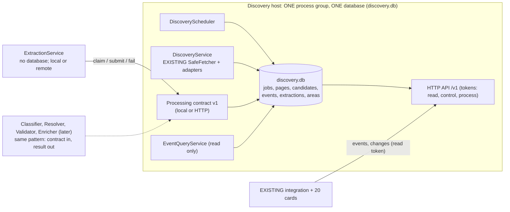
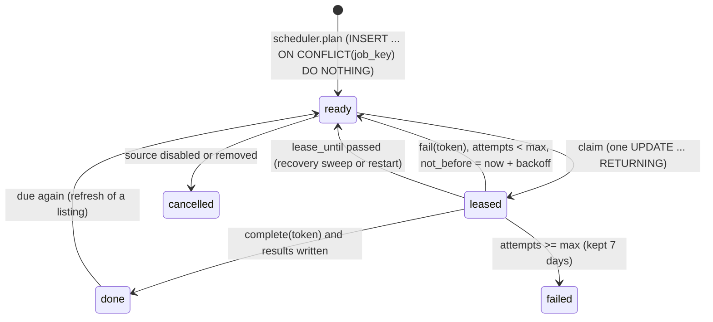
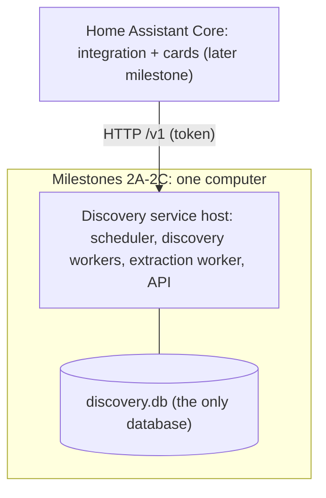
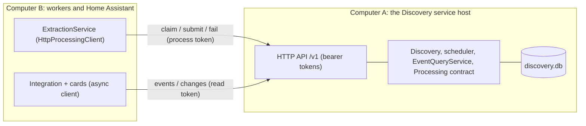

# Discovery Service architecture

Status: **Milestone 2A implemented** (section 0); sections 1–14 are the Phase A design it follows, kept for reference. Where the implementation differs from the design, section 0 is authoritative. Accepted runtime tag `area-events-imagery-runtime-accepted-2026-10-22` is unchanged. Companion documents: [architecture-modules.md](architecture-modules.md) and [discovery-architecture-review-manifest.md](discovery-architecture-review-manifest.md).

---

## 0. As implemented (Milestone 2A)

Package `area_events/discovery/service/` (standard library only, `sqlite3` with SQLite ≥ 3.35 for `RETURNING`):

| Module | Object(s) | Responsibility |
|---|---|---|
| `contracts.py` | `SourceRecord`, `PageRecord`, `CandidateRecord`, `EvidenceRecord`, `Change`, `ChangeBatch`, `SnapshotPage`, `CandidateQuery`, `JobCounts`, `DiscoveryStatus`, `RunReport`; protocols `DiscoveryReader`, `SourceAdapter` | transport-independent records with stable string keys (schema `discovery.v1`) |
| `urls.py` | `canonical_url`, `url_key` | canonical page identity (scheme/host case, default ports, fragments, tracking parameters, query order, percent-encoding) |
| `schema.py` | `MIGRATIONS` | ordered, append-only migrations (version 1 today) |
| `store.py` | `DiscoveryStore`, `WriteStats`, `StorageUnavailable`, `StaleLease` | the file and its connections: one coordinated write connection (`BEGIN IMMEDIATE`, bounded retry on busy), a new `query_only` connection per read, pragmas, migrations, sizes |
| `repositories.py` | `SourceRepository`, `PageRepository`, `CandidateRepository`, `JobRepository`, `ChangeLog`, `Retention` (+ `SourceSpec`, `RetentionPolicy`) | explicit SQL per entity; writes take the caller's transaction |
| `fetching.py` | `RecordingFetcher` | the only fetch client an adapter gets: wraps the injected SafeFetcher, enforces the job's request budget, records every response |
| `adapters.py` | `CityOfSanDiegoAdapter` | the EXISTING `sources/sandiego_gov.py` behind `SourceAdapter`, unchanged |
| `service.py` | `DiscoveryService`, `DiscoveryConfig` | register sources, claim jobs, crawl outside transactions, store results under a lease, release with backoff, pause on storage failure, retention |
| `reader.py` | `LocalDiscoveryReader` | the `DiscoveryReader` contract over the local database: `changes`, `snapshot`, `candidate`, `candidates`, `page`, `acknowledge`, `status` |
| `app.py` | `build()`, `DiscoveryApp`, `KNOWN_SOURCES` | the composition root |
| `cli.py`, `scripts/discovery.py` | `run`, `status`, `inspect` | the command line (no Home Assistant needed) |

Also changed: `safe.py` gained `HostPolicy` (per-host spacing, robots.txt cache, and 429/503 backoff with `Retry-After`), injected into every SafeFetcher of the new path; `safe._STATE` remains only as the default of the legacy runtime. `evidence.visible_text` moved from the workbench so both use it. `classifiers._current` is untouched (the new service has no classifier).

**Tables (migration 1):** `sources` (identity, adapter, options, interval, last attempt/success), `pages` (one row per canonical URL: `url_key`, status of the last fetch, current `content_hash`, readable-text `fingerprint`, timestamps), `source_pages` (many-to-many attribution with role and first/last seen), `contents` (deduplicated zlib bodies keyed by sha256, ≤ 2 MB each), `fetches` (request history), `candidates` (adapter output keyed by the existing event id, `payload_hash`, start time, page), `evidence` (field, kind, exact quote, page and content), `jobs` (state `ready|leased|done|failed`, `next_run_at`, attempts, lease owner/token/expiry, runs), `changes` (AUTOINCREMENT sequence; `upsert` and `delete`), `consumers` (acknowledged sequence), `store_meta` (`pruned_through_seq`), `schema_migrations`. Constraints: foreign keys with cascades, uniqueness of every stable key, CHECKs on states, sizes, intervals and lease consistency.

**Corrections from the review, as built:**

- *Reusable jobs*: one claim statement treats `ready`, `done` (completed) and `failed` jobs as claimable when `next_run_at` has passed, and `leased` jobs whose lease expired; it runs inside `BEGIN IMMEDIATE`, so a job is never claimed twice.
- *Lease-safe writes*: the store transaction first checks the lease token **and** expiry, then writes pages, attribution, contents, fetches, candidates, evidence and changes, then completes the job with the same check; a stale worker raises `StaleLease` and the whole transaction rolls back.
- *Canonical identity*: `pages.url_key` is unique; `source_pages` records each discovering source and role.
- *Shared fetch policy*: `app.build` creates one `HostPolicy` and the SafeFetcher with it; adapters receive only a `RecordingFetcher` around that client.
- *No classifier global* in the new path.
- *Change-feed retention*: changes are pruned only below every consumer's acknowledgement and after a minimum age, with a hard cap; `pruned_through_seq` makes `changes(after)` answer `resync_required` for an older checkpoint; `snapshot()` pages through current candidates with an `as_of_seq` after which changes continue (at-least-once, idempotent by `payload_hash`). Evidence and the content it or a page's current state references are never pruned; removed candidates emit `delete` changes.

**Page changes:** many pages carry random ids (the City's Drupal pages change a `js-view-dom-id` on every request), so a page counts as changed only when its readable text changes (`fingerprint`); otherwise only the fetch is recorded and no new snapshot is stored.

**Failure behaviour:** a fetch failure releases the job with backoff (900 s doubling, 4 attempts, then the next regular run); a database that stays locked, is full or fails makes the service pause for 60 s doubling to 1 hour, the job's lease then expires and the run is repeated: nothing is marked done that was not stored.

**Deliberately deferred:** marking candidates withdrawn when a source stops listing them; page-level jobs (one `crawl_source` job per source runs the whole adapter); the scheduler loop, settings and intensity controls; source metrics and interest regions; the HTTP transport; conditional requests (ETag/Last-Modified, now returned in `Response.headers`); a processing consumer. The old Home Assistant runtime is unchanged and still uses its own engine.

**Commands:**

```
python scripts/discovery.py run [--source san-diego-city] [--db PATH] [--pages N] [--details N] [--now]
python scripts/discovery.py status [--db PATH]
python scripts/discovery.py inspect [--db PATH] [--limit N] [--source KEY] [--title TEXT]
```

Default database: `data/discovery/discovery.db` (Git-ignored).

**Measured (2026-10-22, development Windows PC, live www.sandiego.gov, 2 listing pages and up to 10 event pages per run):** first run 12 requests, 12 pages stored and 22 URLs known, 20 candidates, 109 evidence references, 32 changes, about 25 s (dominated by the 2 s per-host spacing); a second process the same minute found the job not due (0 requests); a forced second run read the 10 remaining event pages (12 requests; both listings unchanged, 10 candidates changed by their event pages, 10 unchanged, 20 changes); a third forced run made 2 requests and stored nothing new (20 candidates unchanged, 0 changes). Database 612 KB after checkpoint, WAL 0–555 KB during runs, 22 snapshots (2.9 MB before compression). Write transactions: p50 about 0.5 ms, p95 about 21 ms (the large store transaction). Peak Python allocation per run about 3 MB (tracemalloc). Twenty concurrent reader threads with different filters while a writer committed continuously: all results correct, 0 lock retries, 0 lock failures, read p50 4–5 ms and p95 220–455 ms (thread scheduling and per-read connection opening on this PC), write p50 0.7 ms, p95 2–3 ms. These are not Raspberry Pi measurements.

---

## 0b. As implemented (Milestone 2B: persistent service and control plane)

**What exists.** The service now runs on its own (`discovery.py serve`), is configured through a versioned, authenticated HTTP/JSON API, and
crawls what its configured *areas* need whether or not any card or Home Assistant is running. Verified by `tests/test_discovery_control.py`
(31 tests) on top of the 25 from 2A; the whole suite is 590 Python tests plus 91 card tests.

**Planes.** Control plane = areas, settings, pause/resume (small, revision-checked commands). Data plane = candidates, pages, the change feed
(read-only to consumers). A card's display filters stay private to the card and never reach the service.

**Schema (migration 2).** `areas`, `area_sources` (many-to-many), `settings` (mode, intensity, paused, revision, scheduler_seen_seq),
`sources.quiet_runs`; `changes` gained a typed `kind` and the entities `area`, `settings`, `discovery`. Existing 2A data and sequence numbers
are preserved (tested).

**Contracts** (`control.py`, schema `discovery.control.v1`): `get_status`, `list_areas`, `get_area`, `create_area`, `update_area`,
`set_area_enabled`, `set_discovery_mode`, `pause`, `resume`. Rules: input validated (name, lat/lon, radius ≤ 250 mi / 400 km, unit,
intensity, source keys); updates need `expected_revision` (stale → `RevisionConflict` with the current revision); a command is saved, its
change record appended and the revision bumped in one transaction; the acknowledgement means "saved". Idempotent: `request_id` on creation,
and a command that changes nothing (same state, same values) returns `replayed: true` and writes nothing. No SQL or internal object crosses
the boundary. Changes are not re-geocoded: the centre is stored as given, and unverified coordinates never cause evidence to be refused.

**Change kinds.** `area.configuration_changed`, `discovery.settings_changed`, `discovery.paused`, `discovery.resumed`, plus the 2A
`candidate.*` / `page.*` kinds, all in one monotonic `seq`. Consumers keep their own checkpoints; the durable feed is authoritative.
Notifications would only be hints; none is needed yet (revision-based polling of `/v1/changes`).

**Scheduler** (`scheduler.py`). A source is eligible only if an enabled area uses it; however many areas or cards share it there is one job
per source. `plan()` runs each host cycle: if the settings/area change records advanced past `scheduler_seen_seq` it records that it noticed
and pulls an already scheduled job forward when the new intensity is faster (never pushes one later). Pacing (`AreaPacing`): interval ×2 for
low, ×1 normal, ×0.5 high; in automatic mode a source unchanged for 2+ / 4+ runs is asked for half / quarter as often; floor 300 s, cap one
day. Provider limits are separate and always win: HostPolicy spacing, robots.txt, 429/503 and Retry-After, failure backoff (900 s doubling,
4 attempts). Pause is a persisted setting; the service returns `paused` without claiming a job.

**Host** (`host.py`). One daemon thread: recover expired leases, plan, run up to `max_jobs_per_cycle` jobs (fairness: every cycle re-claims,
so no source is run twice in a row while another is due), then wait (event-based, never a busy poll; a stop interrupts the wait). A failing
cycle is counted and logged, the wait grows to a cap, and the host keeps running. Each job has a request and a time budget, and a lease, so a
stalled source ends and is retried later without holding the others. `stop()` finishes the current job (bounded by the join timeout); a
job interrupted by a crash is recovered after its lease expires.

**API** (`api.py`, standard library). `GET /v1/discovery/status`, `GET|POST /v1/areas`, `GET|PATCH /v1/areas/{key}`,
`PUT /v1/discovery/settings`, `POST /v1/discovery/pause|resume`, `GET /v1/changes?after=&limit=`, `POST /v1/service/stop`. Bearer tokens
with two scopes (read, control), compared in constant time; read tokens can never mutate (403); 5 failures from a client in 60 s → 429.
Bodies are capped at 8 KiB (declared length checked before reading), JSON objects only, unknown fields rejected, `application/json`
required, socket timeouts, loopback bind unless `--allow-remote`, tokens never logged or echoed. The control token is kept in
`<db dir>/api-token` (mode 600) and referenced by path only.

**Home Assistant.** `custom_components/area_events/discovery_client.py` is an async client over an injected session (HA's shared aiohttp
session in production), with typed exceptions and timeouts; tested against the real loopback API without blocking the event loop.
**Deferred:** a config entry, a WebSocket command and a card UI for areas; this needs changes to the legacy integration and was left out.

**CLI.** `discovery.py serve | stop | status | areas (list/create/update/enable/disable/inspect) | settings | pause | resume | changes | run`.

**Measured** (development machine, simulated pages): 20 concurrent clients × 10 requests while discovery wrote: no errors, request p50 ≈ 25 ms
and p95 ≈ 0.5 s (dominated by thread start-up of the test clients), 24 writes, 0 lock retries, 0 failures.

**Deferred / limitations.** Reader and DoSD adapters; HA config-entry and WebSocket wiring; a processing consumer; marking vanished
candidates withdrawn; a smarter adaptive scheduler than the simple pacing above; TLS (use loopback or a trusted network/reverse proxy).

## 0c. As implemented (Milestone 2C: independent extraction into the one database)

**Decision.** There is exactly one authoritative database: `discovery.db`, owned by the Discovery Service on its host. There is no `events.db`, no
processing database, no per-city or per-card database and no replication. Discovery, Extraction (and later Classification, Geolocation,
Validation and Presentation) are separate objects that own algorithms and in-memory state, not data. Remote components use the versioned API,
never a shared SQLite file. The Phase A two-database design in sections 2, 3, 7 and 8 is superseded; those sections are kept for history and
patched where they named `events.db`.

**Schema (migration 3).** `events` (one row per real-world event: stable `event_key`, title, description, UTC start/end, timezone, `venue_name`,
`location_text`, `address`, `location_status`, source URL, `status`, `missing_json`, `revision`), `event_candidates` (each candidate links to one
event as `primary` or `duplicate`), `extractions` (every result ever submitted, tied to the candidate's `payload_hash` it was made from, the
extractor name and version; unique per result), `event_revisions` (per revision: the extraction and `{field: [old, new]}`), `processing_work`
(per candidate and extractor: lease, claimed hash, `done_hash`/`done_version`, attempts, next attempt). The `changes` table accepts the entity
`event` (`event.created`, `event.updated`, `event.removed`). Foreign keys cascade from candidates, so retention removes an expired candidate's
extractions, and events that started long ago are pruned with their history.

**Areas and events.** Events are not copied per area or per card. An area reaches an event through the sources that area uses
(`area_sources` → candidates → `event_candidates`), so overlapping areas share rows and a source crawled once serves every area that uses it.
Events have **no coordinates** yet (no geolocation component), so area filtering is by serving source, and each event says how its location is
known (`location_status`: `address`, `venue`, `description_only`, `unknown`). Nothing is geocoded or invented.

**Identity.** `event_key = ev-<sha256(first candidate_key)[:20]>`, kept for the life of the event. Candidate and event are 1:1 unless another
candidate has the same normalized title, start and street address (only when an address exists): it is then linked as a `duplicate`
(provenance only; the primary candidate defines the fields). Cross-source duplicate detection beyond that is backlog.

**Processing contract** (`processing.py`, `discovery.processing.v1`). Work is derived, not queued: a candidate is pending for an extractor
version when it has no completed result for its *current* `payload_hash` at that version. A source revision or a better extractor therefore
makes work reappear by itself.
- `claim(worker, extractor, version, limit, lease_s)`: one write transaction leases the oldest pending candidates (leases expire; retries respect
  their backoff) and returns each candidate's payload, evidence rows and the *stored* readable text of its page. No website is fetched again.
- `submit(candidate_key, extractor, version, lease_token, result)`: **one transaction** checks the lease, checks the candidate still has the leased
  `payload_hash` (otherwise `stale_result`: the result is discarded and the item is released), validates the result (types, lengths, no unknown
  fields, at most 60 KB), stores the extraction, creates/updates the event and its revision, marks the work done and appends the change record.
  All of it commits together or none of it does. An identical retry returns `replayed` without writing.
- `fail(...)`: bounded retries (5 min doubling, 4 attempts), then the item waits until its source revision or the extractor version changes.
- `status(extractor, version)`: counts. The service recomputes `location_status`, `missing` and `status` itself; it never trusts them from a worker.

**ExtractionService** (`extraction.py`). Constructor-injected client (`LocalProcessingClient` or `HttpProcessingClient`), extractor, clock and
config; its own thread; `run_once`, `start`, `stop`, `status`; capped error backoff; an extractor exception fails that item only. It holds no
database handle (a test enforces this). `StoredCandidateExtractor@1` is a pure function of one stored candidate: ISO times with an offset become
UTC epochs (a time *without* an offset is a recorded failure, never a guess); an end before the start is dropped; the source's `venue` text is
kept as `venue_name` only when it is short and not a sentence, otherwise as `location_text`; a missing address is taken from the event's own
description only when it names exactly one street address; each field carries its origin and the candidate's evidence references (quotes exist
only where the text was found verbatim). It reuses the existing `textloc` and `evidence` algorithms. No confidence numbers are produced.

**API additions.** `GET /v1/events` (filters `area`, `source`, `from`, `to`, keyset `after`, `limit` ≤ 200), `GET /v1/events/{key}` (revision
history and field evidence), `POST /v1/processing/claim|submit|fail` and `GET /v1/processing/status`. Tokens now have three scopes: `read`,
`control` and `process`. Only a `process` token may claim or submit, and it may use nothing else; read and control tokens cannot submit results.
The process token lives in `<db dir>/api-process-token` (mode 600). Result submissions may be 64 KB; every other body stays at 8 KB.

**CLI.** `serve` also runs a local extraction worker (`--no-extract` to disable); `extract --db PATH | --url URL --token-file FILE [--once]` runs a
worker locally or remotely; `events [--area ID] [--source KEY] [--limit N] | --event KEY`; `status` shows event and extraction counts.

**Known product-quality backlog** (not addressed by 2C; row counts are not evidence of quality):
1. Automatic discovery of previously unknown event sources in an area.
2. Extraction accuracy: the City listing gave the multi-day carnival a 7:00 AM–11:00 PM span although its description lists different evening hours per day; the City adapter appends a California city only, so non-California street addresses stay partial; the stored `venue` is almost always a description of a location, not a venue name.
3. Classification ambiguity.
4. Missing or ambiguous locations: 8 of the 20 stored City events have no street address (`description_only`).
5. Recurring events (each occurrence is its own candidate today).
6. Rescheduling and cancellation (a changed time updates the event; a vanished event is not yet marked withdrawn).
7. Source disappearance and withdrawal.
8. Duplicate identity across sources (only same title, start and address merge).
9. PDFs, scanned flyers and bulletins.
10. Discovery freshness and source coverage (one live source today).

---

## 1. Findings from the current code

### A. Reusable capabilities (EXISTING)

| Capability | Where | Reuse |
|---|---|---|
| Safe fetching: public addresses only, pinned connections, validated redirects, robots.txt (RFC 9309), per-host spacing, size, time and content-type limits, binary mode | `area_events/discovery/safe.py` (`SafeFetcher`, `State`) | as is, but its host-politeness state becomes an injected instance (see D) |
| Polite fetching with robots and fixed delay for registry adapters | `core.Fetcher` | as is (it is already instance-owned) |
| Registry of sources with coverage, options and adapter modules | `registry.py` (`load_sources`, `Source`, `select_sources`), `sources.json` | the seed of the `sources` table |
| Source adapters (listing + detail parsers) | `sources/sandiegoreader.py`, `dosd.py`, `sandiego_gov.py`, `kpbs.py`, `localist.py`, `web.py` | wrapped unchanged in milestone 2B; they already return candidates in a stable dict format |
| Bounded website crawl: structured data, feeds, embedded calendars, hub links, PDFs, text | `sources/web.py` (`_Crawl`), `webdiscover.py`, `webparse.py`, `webfeeds.py`, `webtext.py` | the page-level steps become discovery jobs later; today it is one call per site |
| Resumable detail work with backoff | `sources/detailwork.py` (`DetailWork`) | its state model (attempts, `retry_after`, version) maps directly onto the `jobs` table |
| Event record and evidence | `core.make_event`/`finish_event`, `evidence.py`, `extraction.method`/`source_text` | the candidate payload and evidence references |
| Replaceable classifier contract | `classifiers.py` | the model for every processing contract |
| Background imagery worker with its own store and rate limits | `media.py` (`MediaService`, `MediaStore`) | stays on the processing side; already independent of the discovery thread |
| Diagnostic runner over production code | `workbench.py` | becomes the inspector of the discovery database (read-only API) |
| Authenticated app API, Supervisor discovery, token | `server.py`, `supervisor.py`, `custom_components/area_events/client.py` | the transport for a remote Discovery API later |

### B. Mixed responsibilities

- **`refresh.refresh`** fetches every source, normalizes text, locates, merges, classifies, chooses images and writes the feed **in one synchronous call**: discovery and all processing share one run.
- **`engine.Engine`** schedules runs, owns profile lifecycle, assembles API answers, and starts the imagery loop.
- **Each adapter** pages listings, parses them and fetches details inside one `discover()` call.
- **`web.discover`** extracts, validates dates and time zones, and removes duplicates.
- **`media.py`** mixes geographic resolution, venue-photo verification, map rendering, its store and the worker loop.

### C. What blocks independent discovery today

1. **Discovery is driven by cards.** A card's profile (area, radius, websites) is the unit of work: `Engine.register` enqueues a full crawl for every new profile, and every distinct area crawls *all* its sources again (`engine._run` → `refresh.refresh`). Overlapping areas fetch the same pages twice.
2. **Processing is inside the discovery path.** A slow source parser, the merge, classification or the city geocoder (`place.CityResolver`) delays the next source and the next profile.
3. **Discovery stops for imagery and imagery waits for discovery.** `engine._media_loop` runs only while no profile is discovering; they share one process and one data folder.
4. **Capacity is tied to card variety.** `MAX_PROFILES = 12`: twenty cards with different areas, radii or websites exceed it today (HTTP 429, "too many different areas").
5. **No page identity.** Pages exist only transiently inside a run (and in a 15-minute in-memory cache), so nothing can be re-processed without crawling again.

### D. Where mutable state lives

| State | Location | Kind | Problem under the new rules |
|---|---|---|---|
| Per-host request spacing and robots.txt cache | `safe._STATE` (module global `State()`) | process-wide by design (politeness across fetchers) | global mutable state; becomes a `HostPolicy` instance owned by DiscoveryService and injected into every fetcher |
| Crawl result cache | `sources/web._cache`, `_cache_lock` | module global, 15 minutes, 24 entries | global cache; replaced by the `pages` table (and an instance cache if still needed) |
| Installed classifier | `classifiers._current` | module global set by `use()` | violates "no implicit singletons"; the composition root passes the classifier to its consumers; `use()` stays only as a test convenience or is removed |
| stdout/stderr redirection during a run | `engine._run` uses `contextlib.redirect_stdout` | process-global side effect while a run is active | other threads' prints are captured; replaced by a logger passed to adapters |
| Profiles, queue, running flag, feed cache | `Engine` instance (`_profiles`, `_queue`, `_feeds`) | instance-owned, persisted as JSON per profile | fine as objects; persistence moves to SQLite |
| Per-source event cache, detail state | `<data>/profiles/<id>/source-cache.json` | JSON file per profile | duplicated per profile; moves into the discovery database |
| Feeds | `<data>/profiles/<id>/events.json` | JSON file per profile | becomes the validated-event read model |
| Imagery records, tiles, files | `<data>/media/index.json`, `media/files`, `media/tiles` | instance-owned store (`MediaStore`) | stays with Enrichment; its own store |
| Geocoding caches | `geocode-cache.json`, `location-cache.json` | JSON files | stay with their owners (search area: Presentation/profile service; city estimates: Geographic Resolution) |
| Integration hub records | `custom_components/area_events/hub.Hub._records` | instance-owned, in memory | fine |
| Card state | each card element instance, filters in HA `frontend/user_data` | instance-owned per card | fine; already isolated per card |
| Immutable tables (lexicon, suffixes, regexes, providers) | `classify.py`, `media.py`, `location.PROVIDERS` | immutable constants or stateless objects | permitted |

### E. How things are identified today

| Thing | Identifier |
|---|---|
| Source | registry id (`sandiegoreader`, `dosd`, `sandiego_gov`, …); typed-in websites `web_<sha1(url)[:8]>`, `localist_<sha1(host)[:8]>` (`engine._probe_added`) |
| Profile (card request) | `sha256(normalized profile)[:16]` (`profiles.profile_id`), also the folder name |
| Event | `<source_id>:<local_id>`; local ids come from the adapter (Reader `?et=`, DoSD path, City `slug@date`, web `sha1(uid, url, title, start)[:12]`) |
| Page / document | **none**; URLs appear only inside events |
| Location record | `media.make_key` hashes of the normalized place (`a:…`, `v:…`, `x:…`, `g:…`) |

### F. What moves into SQLite (discovery database)

Sources and their configuration and schedules (from `sources.json`, typed-in websites and profile coverage), URLs, fetch history, bounded page and document content, source candidates with evidence, crawl jobs with retry state (today `extraction.detail_*` in cached events), source yield and freshness metrics, and a change log for consumers. Not moved: feeds, imagery, geocoding caches and card preferences, which belong to the processing side.

### G. How existing processing can consume discovery without coupling

Processing never opens the discovery database. It reads a **change feed** through `DiscoveryReader` (an interface with a local and a remote implementation): "give me changes after sequence N, at most K". Each change names a stable key (`candidate_key`, `page_key`), the payload and a content hash. The existing pipeline (`normalize_event_text` → `locate_events` → `build_document` → classifier) runs in a processing worker on those candidates, exactly as `refresh.build_document` does today on cached events.

### H. Keeping the HA runtime stable

The integration (`client.py`, `hub.py`, `websocket_api.py`) and the card talk only to the app's HTTP API (`/api/v1/profiles/...`, `/api/v1/media/...`). That API stays byte-compatible through milestones 2A–2D: `Engine.snapshot` keeps serving `events.json`-shaped feeds. The new discovery service runs **beside** the current engine (shadow mode) until 2E switches the feed source to the validated-event store behind the same API. Every stage is switchable by an app option (`discovery_service: off | shadow | on`), so rollback is one option change and an app restart.

---

## 2. Target functional decomposition

| # | Module | Responsibility | Status | Main objects (PLANNED unless marked) |
|---|---|---|---|---|
| 1 | **Discovery Engine** | find and fetch event material; store pages, documents, source candidates, fetch history, jobs and metrics; publish changes | PLANNED (reuses EXISTING fetchers and adapters) | `DiscoveryService`, `DiscoveryScheduler`, `DiscoveryStore` (repositories: `SourceRepository`, `PageRepository`, `JobRepository`, `CandidateRepository`, `ChangeLog`, `MetricsRepository`), `FetchWorker`, `HostPolicy` |
| 2 | **Information Extraction** | pages/documents/source candidates → `ExtractedEvent` with field-level evidence | EXISTING code (`webparse`, `webtext`, `webfeeds`, adapter parsers), PLANNED as `Extractor` contract + `ExtractionWorker` | `Extractor`, `ExtractionWorker` |
| 3 | **Event Classification** | event → category decision | EXISTING contract (`classifiers.py`) | `Classifier` (EXISTING), `KeywordClassifier` (EXISTING) |
| 4 | **Geographic Resolution** | event → resolution (where, how sure, why) | EXISTING code (`place.py`, `media.candidate_for`, `MediaService.resolve`), PLANNED `Resolver` contract | `Resolver`, `NominatimResolver` |
| 5 | **Validation / Deduplication** | accept or reject, merge duplicates across sources, expiry | EXISTING code (`web.discover` checks, `merge.py`, `build_document`), PLANNED `Validator` contract | `Validator`, `Merger` |
| 6 | **Event Enrichment** | maps, venue photographs, illustrations, photo subjects | EXISTING code (`media.py` imagery half, `maps.py`, `images.py`, `photo_subject.py`), PLANNED `Enricher` contract | `MapEnricher`, `VenuePhotoEnricher` |
| 7 | **Home Assistant Presentation** | answer card queries from the validated-event store; serve imagery | EXISTING (`server.py`, `engine.snapshot`, integration, card), PLANNED `EventQueryService` | `EventQueryService`, `EventStore` (read model) |



---

## 3. Database ownership

| Database | Host | Owner (only writer) | Contents | Accessed by others through |
|---|---|---|---|---|
| `discovery.db` (+ `-wal`, `-shm`) | Discovery host, `<data>/discovery/` | the database-owning service (`DiscoveryStore`, one writer) | sources, schedules, areas, URLs, pages, bounded content, fetch log, candidates, evidence, jobs, change log, **and (2C) normalized events, extraction results and revisions, processing work** | `DiscoveryReader`, `EventQueryService`, the Processing contract (in process or over the HTTP API); never the file |
| `media/` files + `index.json` | Processing host | Enrichment (`MediaService`) | maps, photographs, tiles | `/api/v1/media/<name>` |

Ownership rules: there is **one** authoritative database. Raw source material, crawl history and derived events all live in `discovery.db`; components own their algorithms and in-memory state, never a database of their own; derived rows hold keys and content hashes of the evidence they came from, never copies of pages. Card preferences stay in Home Assistant user data. (The Phase A proposal of a second `events.db` was dropped in Milestone 2C.)

---

## 4. Proposed `discovery.db` schema (SQLite, schema version 1)

Connection pragmas (every connection): `foreign_keys=ON`, `busy_timeout=5000`. Database-level: `journal_mode=WAL`, `synchronous=NORMAL`, `wal_autocheckpoint=1000`, `journal_size_limit=67108864`. Times are UTC epoch seconds (INTEGER). Text keys are stable across hosts; integer ids are local.

```sql
CREATE TABLE schema_migrations (version INTEGER PRIMARY KEY, applied_at INTEGER NOT NULL, description TEXT NOT NULL);

CREATE TABLE sources (
  source_id      INTEGER PRIMARY KEY,
  source_key     TEXT NOT NULL UNIQUE,            -- 'sandiegoreader', 'web_1a2b3c4d' (EXISTING ids)
  adapter        TEXT NOT NULL,                   -- 'sandiegoreader' | 'web' | 'localist' | ...
  base_url       TEXT NOT NULL,
  origin         TEXT NOT NULL CHECK (origin IN ('registry','user','discovered')),
  coverage_json  TEXT NOT NULL,                   -- {"type":"area",...} as in registry.py
  options_json   TEXT NOT NULL DEFAULT '{}',
  enabled        INTEGER NOT NULL DEFAULT 1 CHECK (enabled IN (0,1)),
  safe_fetch     INTEGER NOT NULL DEFAULT 0 CHECK (safe_fetch IN (0,1)),   -- typed-in addresses use SafeFetcher
  created_at     INTEGER NOT NULL, updated_at INTEGER NOT NULL
);

CREATE TABLE source_schedules (
  source_id        INTEGER PRIMARY KEY REFERENCES sources(source_id) ON DELETE CASCADE,
  interval_s       INTEGER NOT NULL CHECK (interval_s >= 900),
  next_due_at      INTEGER NOT NULL,
  backoff_until    INTEGER,                        -- set after HTTP 429/503 or repeated failures
  consecutive_failures INTEGER NOT NULL DEFAULT 0,
  last_success_at  INTEGER, last_attempt_at INTEGER
);
CREATE INDEX source_schedules_due ON source_schedules(next_due_at);

CREATE TABLE interest_regions (                     -- why a source is active: the areas cards asked for
  region_key   TEXT PRIMARY KEY,                    -- EXISTING profile_id
  latitude REAL NOT NULL, longitude REAL NOT NULL, radius_miles REAL NOT NULL CHECK (radius_miles > 0),
  last_requested_at INTEGER NOT NULL
);

CREATE TABLE urls (
  url_id      INTEGER PRIMARY KEY,
  url_key     TEXT NOT NULL UNIQUE,                 -- sha256(normalized url)[:32]
  url         TEXT NOT NULL,
  source_id   INTEGER NOT NULL REFERENCES sources(source_id) ON DELETE CASCADE,
  role        TEXT NOT NULL CHECK (role IN ('listing','hub','detail','feed','calendar','document','other')),
  discovered_from INTEGER REFERENCES urls(url_id) ON DELETE SET NULL,
  depth       INTEGER NOT NULL DEFAULT 0 CHECK (depth BETWEEN 0 AND 3),
  first_seen_at INTEGER NOT NULL, last_seen_at INTEGER NOT NULL
);
CREATE INDEX urls_source ON urls(source_id, role);

CREATE TABLE fetches (                              -- one row per request made (history; bounded retention)
  fetch_id     INTEGER PRIMARY KEY,
  url_id       INTEGER NOT NULL REFERENCES urls(url_id) ON DELETE CASCADE,
  job_id       INTEGER REFERENCES jobs(job_id) ON DELETE SET NULL,
  started_at   INTEGER NOT NULL, finished_at INTEGER NOT NULL,
  outcome      TEXT NOT NULL CHECK (outcome IN ('ok','not_modified','http_error','blocked','robots','timeout','too_large','unsupported','network')),
  http_status  INTEGER, content_type TEXT, bytes INTEGER, final_url TEXT, error TEXT,
  etag TEXT, last_modified TEXT
);
CREATE INDEX fetches_url_time ON fetches(url_id, finished_at DESC);

CREATE TABLE contents (                             -- bounded, deduplicated bodies
  content_hash TEXT PRIMARY KEY,                    -- sha256 of the raw body
  media_type   TEXT NOT NULL,
  bytes        INTEGER NOT NULL CHECK (bytes <= 2000000),
  body         BLOB NOT NULL,                       -- zlib-compressed
  stored_at    INTEGER NOT NULL
);

CREATE TABLE pages (                                -- the current version of each URL's content
  url_id       INTEGER PRIMARY KEY REFERENCES urls(url_id) ON DELETE CASCADE,
  content_hash TEXT NOT NULL REFERENCES contents(content_hash),
  fetch_id     INTEGER NOT NULL REFERENCES fetches(fetch_id),
  fetched_at   INTEGER NOT NULL,
  changed_at   INTEGER NOT NULL                     -- when the hash last changed
);

CREATE TABLE candidates (                           -- source candidates: what the source states, as the adapter read it
  candidate_id  INTEGER PRIMARY KEY,
  candidate_key TEXT NOT NULL UNIQUE,               -- EXISTING event id '<source_key>:<local_id>'
  source_id     INTEGER NOT NULL REFERENCES sources(source_id) ON DELETE CASCADE,
  url_id        INTEGER REFERENCES urls(url_id) ON DELETE SET NULL,        -- the page it was read from
  method        TEXT NOT NULL,                      -- 'jsonld','microdata','ics','feed','html','text','pdf','adapter'
  extractor     TEXT NOT NULL,                      -- e.g. 'sources/sandiegoreader@1'
  payload_json  TEXT NOT NULL,                      -- the candidate dict (EXISTING adapter output format)
  payload_hash  TEXT NOT NULL,
  starts_at     INTEGER, ends_at INTEGER,
  first_seen_at INTEGER NOT NULL, last_seen_at INTEGER NOT NULL,
  withdrawn_at  INTEGER                              -- no longer listed by the source
);
CREATE INDEX candidates_source_start ON candidates(source_id, starts_at);

CREATE TABLE evidence (                             -- field-level references (evidence.py structure)
  evidence_id  INTEGER PRIMARY KEY,
  candidate_id INTEGER NOT NULL REFERENCES candidates(candidate_id) ON DELETE CASCADE,
  field        TEXT NOT NULL,
  kind         TEXT NOT NULL CHECK (kind IN ('extracted','inferred','recorded')),
  quote        TEXT CHECK (quote IS NULL OR length(quote) <= 400),
  content_hash TEXT REFERENCES contents(content_hash),
  note         TEXT
);
CREATE INDEX evidence_candidate ON evidence(candidate_id);

CREATE TABLE jobs (
  job_id       INTEGER PRIMARY KEY,
  job_key      TEXT NOT NULL UNIQUE,                -- idempotency: '<kind>:<source_key>:<url_key>'
  kind         TEXT NOT NULL CHECK (kind IN ('crawl_source','fetch_page','fetch_detail','fetch_document')),
  source_id    INTEGER NOT NULL REFERENCES sources(source_id) ON DELETE CASCADE,
  url_id       INTEGER REFERENCES urls(url_id) ON DELETE CASCADE,
  priority     INTEGER NOT NULL DEFAULT 50 CHECK (priority BETWEEN 0 AND 100),
  state        TEXT NOT NULL CHECK (state IN ('ready','leased','done','failed','cancelled')),
  not_before   INTEGER NOT NULL,
  attempts     INTEGER NOT NULL DEFAULT 0,
  max_attempts INTEGER NOT NULL DEFAULT 6,
  lease_owner  TEXT, lease_token TEXT, lease_until INTEGER,
  last_error   TEXT,
  created_at   INTEGER NOT NULL, updated_at INTEGER NOT NULL
);
CREATE INDEX jobs_claim ON jobs(state, not_before, priority DESC, job_id);
CREATE INDEX jobs_lease ON jobs(state, lease_until);

CREATE TABLE changes (                              -- the change feed for consumers (outbox)
  seq          INTEGER PRIMARY KEY AUTOINCREMENT,   -- monotonic; never reused
  entity       TEXT NOT NULL CHECK (entity IN ('candidate','page','source')),
  entity_key   TEXT NOT NULL,
  op           TEXT NOT NULL CHECK (op IN ('upsert','withdraw')),
  payload_hash TEXT NOT NULL,
  created_at   INTEGER NOT NULL
);
CREATE INDEX changes_entity ON changes(entity, entity_key);

CREATE TABLE consumers (                            -- acknowledged progress, for bounded retention and backlog
  consumer     TEXT PRIMARY KEY,                    -- 'processing@ha-host'
  acked_seq    INTEGER NOT NULL DEFAULT 0,
  acked_at     INTEGER NOT NULL
);

CREATE TABLE source_metrics (                       -- daily roll-up: yield and freshness
  source_id INTEGER NOT NULL REFERENCES sources(source_id) ON DELETE CASCADE,
  day       TEXT NOT NULL,                          -- 'YYYY-MM-DD'
  fetches INTEGER NOT NULL DEFAULT 0, failures INTEGER NOT NULL DEFAULT 0, bytes INTEGER NOT NULL DEFAULT 0,
  new_candidates INTEGER NOT NULL DEFAULT 0, changed_candidates INTEGER NOT NULL DEFAULT 0,
  PRIMARY KEY (source_id, day)
);

CREATE TABLE settings (key TEXT PRIMARY KEY, value_json TEXT NOT NULL, updated_at INTEGER NOT NULL);  -- scheduler mode, intensity, budgets
```

Retention (enforced by `DiscoveryStore.prune`, run by the scheduler in its own short transactions): `fetches` 30 days; `contents` not referenced by `pages` or `evidence` after 7 days; total `contents` bytes ≤ a budget (default 200 MB, oldest unreferenced first); `candidates` withdrawn or ended more than `retention_days` (EXISTING default 3) ago; `changes` below `min(consumers.acked_seq)` and older than 1 day, but never more than 500 000 rows (a consumer that falls behind that far is told to resynchronise from a snapshot); `jobs` in `done/failed/cancelled` older than 7 days.

---

## 5. Objects and contracts

Plain classes with constructor injection; one composition root creates them. No module-level mutable state.

```python
# Discovery host (PLANNED)
class DiscoveryStore:                     # owns the SQLite file and its connections
    def __init__(self, path: str, clock): ...
    def writer(self) -> "WriteSession": ... # the single write connection (one thread), short BEGIN IMMEDIATE transactions
    def reader(self) -> "ReadSession": ...  # a new read-only connection per thread (query_only=ON)
    def migrate(self) -> int: ...; def prune(self, budget) -> dict: ...; def close(self): ...

class SourceRepository / PageRepository / JobRepository / CandidateRepository / ChangeLog / MetricsRepository:
    def __init__(self, session): ...      # each method is one statement or one short transaction; no network inside

class HostPolicy:                         # replaces the module global safe._STATE: per-host spacing, robots.txt cache, backoff
    def __init__(self, clock): ...

class FetchWorker:                        # claims a job, fetches OUTSIDE any transaction, records the result
    def __init__(self, jobs, pages, candidates, fetchers, adapters, policy, clock, worker_id): ...
    def run_once(self) -> bool: ...

class DiscoveryScheduler:                 # decides what becomes a job, and how many at once
    def __init__(self, sources, jobs, metrics, settings, backlog_probe, clock): ...
    def plan(self) -> int: ...            # creates/refreshes jobs; returns how many
    def state(self) -> "SchedulerState": ...

class DiscoveryService:                   # lifecycle: start(), stop(), status(); owns the threads
    def __init__(self, store, scheduler, workers, api): ...

# Contracts used across the boundary (logical; local and HTTP adapters)
class DiscoveryReader:                    # what processing may ask of Discovery
    def changes(self, after_seq: int, limit: int) -> "ChangeBatch": ...
    def candidate(self, candidate_key: str) -> "CandidateRecord": ...
    def page(self, url_key: str, include_body: bool = False) -> "PageRecord": ...
    def acknowledge(self, consumer: str, seq: int) -> None: ...
    def status(self) -> "DiscoveryStatus": ...
class DiscoveryControl:                   # what Presentation/administration may ask
    def register_interest(self, region) -> None: ...; def register_source(self, url) -> "SourceRecord": ...
    def set_mode(self, mode, intensity) -> None: ...

# Processing host (PLANNED unless marked)
class ProcessingService:                  # SUPERSEDED by the Processing contract (processing.py): workers claim work and submit results; the service writes discovery.db
    def __init__(self, reader: DiscoveryReader, store: "EventStore", extractor, classifier, resolver, validator, enrichers, clock): ...
class EventQueryService:                  # the only path from cards to events
    def __init__(self, store: "EventStore"): ...
    def query(self, spec: "QuerySpec") -> "QueryResult": ...
```

Contract records (versioned `discovery.v1`; JSON over HTTP, dataclasses in process):

| Record | Fields |
|---|---|
| `ChangeBatch` | `schema: "discovery.v1"`, `changes: [Change]`, `next_seq`, `latest_seq`, `resync_required: bool` |
| `Change` | `seq`, `entity`, `entity_key`, `op`, `payload_hash`, `record` (a `CandidateRecord` or `PageRecord` inline, bodies omitted) |
| `CandidateRecord` | `candidate_key`, `source_key`, `url_key`, `method`, `extractor`, `payload` (EXISTING candidate/event dict), `payload_hash`, `first_seen_at`, `last_seen_at`, `withdrawn_at`, `evidence: [EvidenceRef]` |
| `PageRecord` | `url_key`, `url`, `source_key`, `role`, `content_hash`, `media_type`, `fetched_at`, `changed_at`, `body` (only when asked, size-capped) |
| `EvidenceRef` | as `evidence.py` (`field`, `value`, `kind`, `recorded_by`, `source_url`, `quote`, `context`, `found_in`, `note`) plus `content_hash` |
| `QuerySpec` | `center`, `radius_miles`, `categories[]`, `date_from`, `date_to`, `source_keys[]`, `sort`, `limit (≤200)`, `cursor`, `since_token` |
| `QueryResult` | `events[]` (EXISTING feed event schema), `next_cursor`, `token`, `generated_at`, `status` |

Composition root (PLANNED `area_events/discovery/app.py`, called from `server.main`):

```python
def build(settings, clock=time.time):
    store = DiscoveryStore(os.path.join(settings["data_dir"], "discovery", "discovery.db"), clock)
    policy = HostPolicy(clock)
    sources, jobs, pages, candidates = SourceRepository(store), JobRepository(store), PageRepository(store), CandidateRepository(store)
    workers = [FetchWorker(jobs, pages, candidates, fetchers=FetcherFactory(policy), adapters=AdapterSet(registry), policy=policy, clock=clock, worker_id=f"w{i}")
               for i in range(settings["fetch_workers"])]          # default 1 on a Raspberry Pi
    scheduler = DiscoveryScheduler(sources, jobs, MetricsRepository(store), SettingsRepository(store), backlog_probe=ChangeLog(store).backlog, clock=clock)
    discovery = DiscoveryService(store, scheduler, workers, api=LocalDiscoveryApi(store))
    engine = Engine(settings["data_dir"], ...)                       # EXISTING, unchanged until 2E
    return discovery, engine
```

---

## 6. Durable discovery job lifecycle



- **Claim** (one statement, deterministic order): `UPDATE jobs SET state='leased', lease_owner=:w, lease_token=:t, lease_until=:now+:lease, attempts=attempts+1, updated_at=:now WHERE job_id = (SELECT job_id FROM jobs WHERE state='ready' AND not_before<=:now AND source_id NOT IN (SELECT source_id FROM source_schedules WHERE backoff_until>:now) ORDER BY priority DESC, not_before, job_id LIMIT 1) RETURNING *`.
- **Fetch** happens after the claim transaction has committed: no network call in a transaction.
- A `crawl_source` job runs an EXISTING adapter unchanged with a **recording fetcher** (the pattern `workbench.RecordingClient` already uses): every page the adapter fetches is stored as a `fetches`/`pages` row, and every candidate it returns as a `candidates` row. Later stages split adapters into `fetch_page`/`fetch_detail` jobs.
- **Complete** in one transaction: insert `fetches`, upsert `contents`/`pages`, upsert `candidates` (`ON CONFLICT(candidate_key) DO UPDATE ... WHERE payload_hash != excluded.payload_hash`), append `changes` only for real changes, update metrics, `UPDATE jobs SET state='done' WHERE job_id=:id AND lease_token=:t`. A stale token (the lease expired and another worker took it) changes nothing: completion is idempotent.
- **Fail**: backoff `min(900 · 2^(attempts-1), 43 200)` seconds (the EXISTING `detailwork` rule), HTTP 429/503 also set `source_schedules.backoff_until` from `Retry-After` when given.
- **Restart recovery**: at start, `UPDATE jobs SET state='ready', lease_owner=NULL, lease_token=NULL WHERE state='leased'` (nothing else can hold a lease while the service is starting); a periodic sweep does the same for `lease_until < now`.
- **Bounds**: at most `max_ready_jobs` (default 2 000) ready jobs per source class; `plan()` creates no new jobs above it.

---

## 7. Processing and HA synchronization boundary

```mermaid
sequenceDiagram
  participant D as DiscoveryService (discovery.db)
  participant P as Worker (no database)
  participant Q as EventQueryService
  participant C as Card (via integration)
  D->>D: job complete: upsert candidate, append change seq=101
  P->>D: changes(after=100, limit=200)
  D-->>P: ChangeBatch(101..140, next=140)
  P->>P: one transaction: upsert extracted/decided events keyed by candidate_key + payload_hash, checkpoint=140
  P->>D: acknowledge(consumer, 140)
  C->>Q: query(QuerySpec)
  Q-->>C: events (read connection; never waits for P or D)
```

- **Checkpoint with the result (as implemented in 2C)**: there is no worker-held checkpoint. Pending work is derived from the candidate's current `payload_hash` and the extractor version, and the checkpoint (`processing_work.done_hash`) commits in the **same transaction** as the extraction and the event, so a crash loses nothing and repeats at most one item; every write is idempotent.
- **Acknowledgement** is advisory for retention and backlog metrics only; losing it loses nothing.
- **Outage**: discovery keeps working and keeps the change log (bounded as above); processing retries `changes()` with backoff (5 s → 5 min) and catches up. If the log was pruned past its checkpoint, `resync_required` makes it page through current candidates by key instead.
- **Rerunning a module**: processing can recompute any stage from `candidate`/`page` records (by key, through `DiscoveryReader`) without crawling again; results are versioned by implementation name (e.g. `classifier: keyword-lexicon`).

---

## 8. Deployment





Remote rules: logical contracts are identical in both deployments (`LocalDiscoveryReader` and `HttpDiscoveryReader` implement one interface); the SQLite file is never shared over a network; every call carries `schema` and a bearer token (the EXISTING token mechanism in `server.py`); all calls are idempotent and paginated; batch size bounds memory on both sides.

---

## 9. Concurrency and failure isolation

| Concern | Design |
|---|---|
| Writers | SQLite allows **one active writer**. `discovery.db`: the writer is `DiscoveryStore.writer()`, used by the fetch workers' completion step and the scheduler, each holding `BEGIN IMMEDIATE` for milliseconds (no network, no parsing inside); `busy_timeout=5000` makes concurrent attempts wait instead of failing. Processing workers never write: they submit results through the Processing contract and the same single writer stores them. |
| Readers | WAL lets readers proceed during writes. API handlers and `EventQueryService` open read-only connections per thread (`PRAGMA query_only=ON`); card reads never block discovery writes, and a long read never blocks the writer (only checkpointing waits, bounded by `wal_autocheckpoint`). |
| Transaction owners | Job claim/complete/fail: `JobRepository` (called by `FetchWorker`); plan and prune: `DiscoveryScheduler`; source registration: `DiscoveryControl`; processing upserts and checkpoint: `ProcessingService`. |
| Parsing | adapters and parsers run on the worker thread between claim and complete; their CPU time never holds a transaction. |
| Slow downstream | discovery never waits for processing: it only appends to `changes`. Backlog = `latest_seq - min(acked_seq)`; above a threshold the scheduler lowers intensity (fewer new-source crawls first). |
| Slow geocoder or imagery | they run in processing workers with their EXISTING rate limits; discovery is unaware of them. |
| Database busy beyond the timeout | the operation is retried with jittered backoff up to 3 times; the job's lease is then left to expire (it will be re-fetched), and the failure is counted in `status()`. |
| Database full / disk budget reached / I/O error | the scheduler enters `paused: storage` (no new claims, so no fetches whose results could not be stored), runs `prune()`, retries a probe write every 60 s, resumes automatically; `status()` and the app log say why. In-flight results are dropped and their jobs re-run later: nothing is acknowledged that was not written. |
| Corrupt database | `PRAGMA quick_check` at start; on failure the file is moved aside and a new one created (discovery re-crawls and extraction re-derives every event from the new candidates). With one database there is no second copy to keep serving: back the file up (SQLite online backup or a copy while stopped). |
| Host politeness | one `HostPolicy` per process enforces robots.txt, Crawl-delay and spacing for every worker; intensity changes the number of jobs, never these limits. |

---

## 10. Scheduler controls (design; a simple scheduler first)

Settings (table `settings`, also app options): `mode` = `automatic` | `manual` | `paused`; `intensity` 1–5 (manual: jobs per minute and parallel workers within limits); budgets: `max_requests_per_hour`, `max_bytes_per_day`, `max_storage_mb`, `fetch_workers`.

Inputs: source yield (`source_metrics.new_candidates` per fetch), freshness (time since `last_success_at` versus `interval_s`), ready/leased job counts, downstream backlog, failures and `backoff_until`, process CPU/RSS and free disk (sampled), the split between **new discovery** (hub/document jobs on sources with high yield) and **refresh** (listings due again).

Milestone 2B scheduler: fixed intervals per source class (registry sources hourly; typed-in websites every 6 hours), one fetch worker, pause/resume, backoff on failures, storage pause. Adaptive weighting comes later and only changes priorities and intervals within the published limits.

Metrics exposed by `DiscoveryStatus`: mode, state (`running`, `paused`, `paused: storage`, `backing off`), jobs by state, oldest ready job age, fetches and failures per hour, bytes stored, change backlog per consumer, last error.

---

## 11. Workbench integration

The EXISTING workbench (`workbench.py`) gains a third input: `python scripts/workbench.py discovery <candidate_key|url_key|source_key>`, which reads records through `DiscoveryReader` (never the database file), then runs the **same** production processing calls it already runs on fixtures. Reports add the fetch history and job state of the page. No second processing engine is built.

---

## 12. Roadmap (refined order)

| Stage | Demonstration | Acceptance tests | Baseline kept / rollback |
|---|---|---|---|
| **2A Store** | `DiscoveryStore` + repositories create `discovery.db` (migrations, WAL); a CLI seeds sources from `sources.json`, records a fetched page and its candidates, survives restart; workbench prints them | schema migrates from empty and is idempotent; pragmas set on every connection; foreign keys enforced; claim/complete/fail/lease-expiry semantics; restart recovery; duplicate completion is a no-op; prune keeps budgets; `sqlite3` import works in the app container | app unchanged; the store is not used by the runtime; rollback = revert the commit |
| **2B Service (shadow)** | `DiscoveryService` with one fetch worker and the simple scheduler runs inside the app beside the EXISTING engine (`discovery_service: shadow`); registry sources' pages and candidates continuously enter SQLite; `/api/v1/discovery/status` | discovery continues while the engine runs a profile; a stalled downstream (fake consumer that never reads) does not stop discovery; restart keeps pending jobs; intensity/pause work; requests stay within HostPolicy limits; no change in card answers (byte comparison of `/api/v1/profiles/<id>`) | option `off` restores today exactly |
| **2C Extraction worker** | DONE (see 0c): an independent extraction worker consumes stored candidates through the Processing contract and the service writes normalized events into `discovery.db`; workbench shows candidate → extracted event | replay of a batch creates no duplicates; a stalled extraction worker does not stop discovery; a crash mid-batch resumes from the checkpoint | feeds still come from the EXISTING engine |
| **2D Remote boundary** | `HttpDiscoveryReader` against the API of a second process (same machine, other port) | disconnect/reconnect loses no change; idempotent retries; schema version check; token required | local reader remains the default |
| **2E Query store and cards** | classification, resolution, validation and enrichment write validated events; `EventQueryService` answers the EXISTING profile API from `discovery.db`; 20 card simulations | 20 concurrent simulated clients with different areas and filters get correct, independent results; reads do not block writes; byte-compatible API; HA runtime verification on the Pi | option switches the feed source back to the EXISTING engine |

Order note: 2C before 2D, because the remote boundary is easier to test once there is a real consumer; 2E last, since it is the only stage that changes what cards see.

---

## 13. Test plan

Simulated (unit or process-level, in `tests/`):

| Property | Test |
|---|---|
| Discovery continues while extraction stalls | a consumer that never calls `changes()`; jobs keep completing and `changes` grows within its bound; scheduler lowers intensity at the backlog threshold |
| A stalled geocoder cannot block discovery | processing resolver that sleeps; discovery throughput unchanged (no shared lock or thread) |
| Pending jobs survive restart | kill the service with jobs `leased` and `ready`; new service instance recovers leases and completes all |
| Duplicate delivery does not duplicate records | deliver the same `ChangeBatch` twice and complete the same job twice (stale token); row counts unchanged |
| 20 card clients | 20 threads issue different `QuerySpec`s against `EventQueryService` while a writer upserts; each result matches a reference filter of the same data; no client sees another's cursor |
| Card reads do not block writes | a long-running read transaction during 100 writer commits; writer latency stays under the busy timeout |
| Contention is bounded | many workers completing at once; no `database is locked` escapes; retries ≤ 3; p95 commit time measured |
| Temporary database failure recovers | inject `sqlite3.OperationalError('database is locked')` and disk-full on the writer; service pauses, then resumes; no acknowledged record missing |
| Remote disconnection loses no evidence | `HttpDiscoveryReader` with a transport that drops every third call; the event tables equal the local run |
| No prohibited mutable global state | a test scans new modules (AST) for module-level assignments of dict/list/set/objects other than constants, for `global` statements, and for module-level connections |
| Replacement needs no consumer change | install an alternative `Classifier`, `Resolver` and `DiscoveryReader` through the composition root only; consumers' tests unchanged |

Home Assistant runtime verification (on the real Pi, after deployment, by the owner): app starts with `discovery_service: shadow` and the database is created under `/data`; cards behave exactly as before; restart of the app keeps `discovery.db` and resumes jobs; CPU and memory stay within the stated budget over a day; `/api/v1/discovery/status` reports progress.

---

## 14. Recommended first implementation slice

Milestone **2A**, deliberately small: `area_events/discovery/store/` with `DiscoveryStore` (connections, pragmas, migrations v1, prune), `SourceRepository`, `UrlRepository`/`PageRepository` (with `contents`), `JobRepository` (claim/complete/fail/recover), `CandidateRepository` + `ChangeLog`; a `HostPolicy` class extracted from `safe._STATE` but used only by the new code; a command `python -m discovery.store seed|crawl-once|show` that seeds sources from `sources.json`, runs **one** registry adapter (for example City of San Diego) through a `FetchWorker`, and stores its pages and candidates; and the tests listed for 2A. The app runtime does not change, so there is nothing to roll back in Home Assistant.
